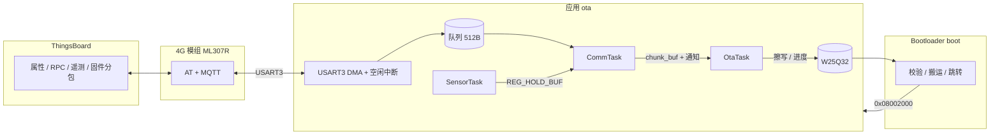
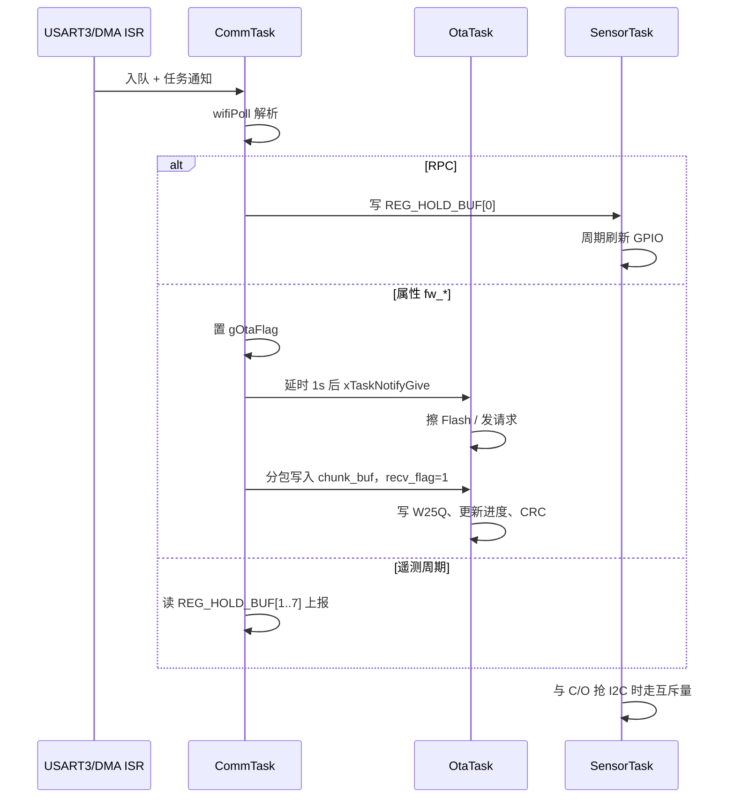
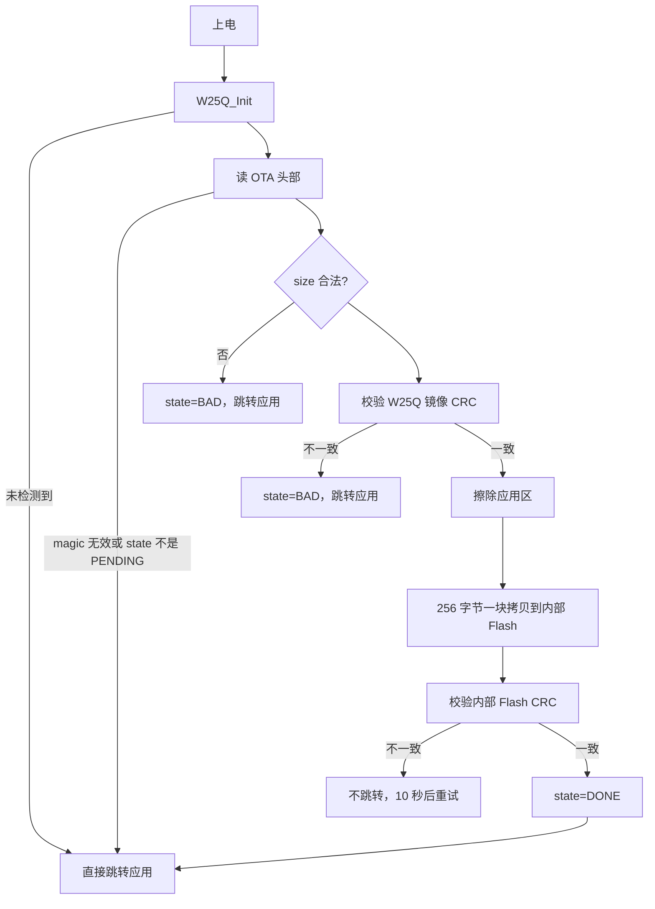
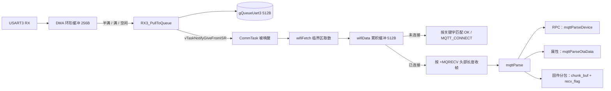
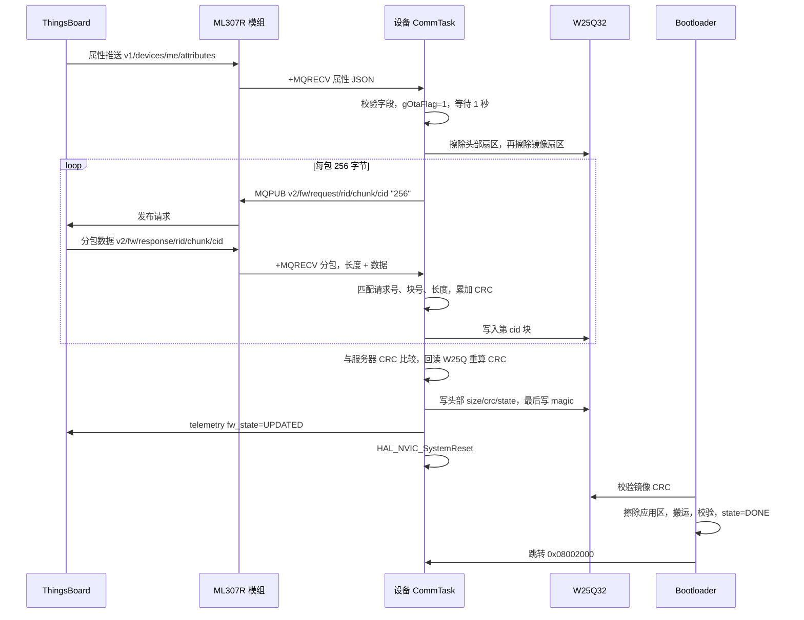

# STM32F103C8 4G OTA 工程：架构与设计

> 本文描述仓库根目录下两个同级 Keil 工程的整体架构、模块职责和设计决策：
> - `ota\`：应用（FreeRTOS、MQTT、OTA 下载）
> - `boot\`：Bootloader（校验、搬运、跳转）
>
> `docs\` 与两者同级。文中未加前缀的 `Core\`、`MDK-ARM\` 默认指应用工程（`ota\`）下的路径；Bootloader 路径一律写 `boot\...`。内存、时间数据是估算或某次编译的快照，以实际 map 文件和实测为准。

## 目录

1. 项目概述
2. 关键设计决策一览
3. 硬件资源、器件规格与总线协议（引脚 / 位序 / 模式 / 帧格式）
4. 存储布局与 OTA 头部
5. 软件架构与任务划分（面试重点：职责 / 优先级 / 交互）
6. Bootloader 设计
7. 应用启动与业务任务
8. 串口接收与 4G 模组通信（含 `wifiData` 线性 vs 环形）
9. 同步、互斥与中断控制（面试重点：手段清单）
10. MQTT 与云端协议
11. OTA 升级实现
12. 资源占用与时间预算
13. 调试与日志
14. 已知问题与风险
15. 目录结构
16. 附录：时间 / 定时 / 超时一览（面试重点；含 IWDG 分频计算与喂狗）

---

## 1. 项目概述

设备通过 4G 模组（ML307R）连接 ThingsBoard（MQTT），完成三件事：

1. **遥测上报**：每 5 秒上报温湿度、电压电流功率、电位器电压、CPU 温度。
2. **远程控制**：接收 RPC，控制 LED1、蜂鸣器、继电器，并回复状态。
3. **OTA 升级**：服务器推送固件信息后，设备分包下载固件到外部 W25Q32，校验通过后重启，由 Bootloader 搬运到内部 Flash 并跳转运行。

| 项目 | 说明 |
| --- | --- |
| MCU | STM32F103C8（64 KB Flash，20 KB RAM），HAL 库 |
| RTOS | FreeRTOS V10.3.1（原生 API，任务/互斥量动态创建，heap_4，堆 8 KB） |
| 4G 模组 | ML307R，USART3，AT 命令 + MQTT |
| 云平台 | ThingsBoard（属性、RPC、遥测、固件分包） |
| 外部存储 | W25Q32（SPI1），仅用作 OTA 暂存区 |
| 其他外设 | OLED、AHT20、INA226（I2C1）；ADC1；LED、蜂鸣器、继电器 |

系统架构图：



工程关系：

- 两个 Keil 工程**各自独立编译、独立烧录**：Bootloader 在 `boot\`，应用在 `ota\`，文档在 `docs\`，三者同级。
- Bootloader 上电先运行，负责校验、搬运、跳转；应用运行 FreeRTOS，负责通信和传感器。
- `w25q.c`、`w25q.h` 在两个工程中是**同一份源码的两个副本**（`ota\Core\...` 与 `boot\Core\...`），修改时需要两边同步。

---

## 2. 关键设计决策一览

下表列出工程里影响全局的设计决策。每条的细节见后面标注的章节。

| 编号 | 决策 | 做法 | 理由 | 代价与约束 | 详见 |
| --- | --- | --- | --- | --- | --- |
| D1 | 外部 Flash 暂存，不做 A/B 分区 | 新固件先下载到 W25Q32，校验通过后再由 Bootloader 搬运到内部应用区 | 内部只有 64 KB，放不下两份 56 KB 的应用；下载过程不影响正在运行的旧程序 | 搬运时要擦除应用区；搬运中途断电依赖 `PENDING` 状态重搬运 | 4、6、11 |
| D2 | 两个工程独立 | Bootloader 固定 8 KB 在 `0x08000000`，应用在 `0x08002000` | 升级只覆盖应用区，引导程序不受影响 | `w25q.c` 两份副本、地址常量需两边一致 | 5.4 |
| D3 | 先校验后擦除，搬运后再校验 | Bootloader 先校验 W25Q 镜像 CRC，通过后才擦内部应用区；搬运完再算一次内部 Flash CRC | 镜像损坏时旧程序仍可运行；内部 CRC 兜底 Flash 写入错误 | 擦除后到搬运完成之前不能回退，只能重搬运 | 6.2 |
| D4 | 头部 `magic` 最后写，状态字靠 NOR 位特性 | 先写 size/crc/state，最后写 magic；状态只从 1 改成 0 | 断电安全；改状态不需要擦除 | 状态取值必须按位包含关系设计 | 4.4 |
| D5 | 先擦头部，再擦镜像 | 下载开始先擦除头部扇区，让旧头部失效 | 下载中途断电或重启，Bootloader 不会误升级 | 下载失败后旧固件不会被自动重新升级 | 11.4 |
| D6 | 时基分离 | HAL 用 TIM1 产生 `HAL_GetTick`，FreeRTOS 用 SysTick | 两者互不争用 | 临界区屏蔽 TIM1 时，`HAL_GetTick` 暂停 | 3.4、16、9.4 |
| D7 | DMA 环形接收 + 三种触发同一入队函数 | 半满、满、空闲三处都调用 `RX3_PullToQueue`，用 DMA 计数器算新增字节数 | 不依赖空闲中断判断帧尾；多次触发结果一致，不重复入队 | 中断延迟超过约 22 ms 时 DMA 静默覆盖 | 8.1、9.6 |
| D8 | 中断只入队，解析放在任务里 | ISR 只做入队和任务通知，帧解析在 `CommTask` | ISR 执行时间短，不阻塞其他中断 | 解析有最多约 10 ms 的延迟 | 8.3 |
| D9 | 串口接收解析单消费者 | 只有 `CommTask` 调用 `wifiPoll` | 避免多任务抢 `wifiData`/队列 | 下载期收包仍依赖 Comm 持续运行 | 5 |
| D10 | 累积缓冲 + 按长度收帧 | 数据先追加到 `wifiData`，`+MQRECV` 按头部长度收齐 | 解决拆包和粘包；二进制载荷只能靠长度定界 | 单条消息不能超过 511 字节；残缺消息 500 ms 后丢弃 | 8.5、8.6 |
| D11 | 两种解析模式 | 未连接按关键字，已连接按帧 | AT 是文本，MQTT 下行是带长度的帧 | 靠 `connected` 切换，需保持一致 | 8.5 |
| D12 | 任务通知代替二值信号量 | ISR 唤醒 Comm；Comm 用通知启动 Ota | 开销小，不另建内核对象 | 每个任务各自一份通知计数 | 5、9.2 |
| D13 | I2C1 用互斥量保护 | OLED、AHT20、INA226 访问前加锁 | 多任务共用一条总线 | 持锁卡死会永久阻塞（`portMAX_DELAY`） | 9.3 |
| D14 | 优先级 Sensor > Comm > Ota | idle+2 / +1 / +0 | Sensor 保心跳/采集不被通信忙等拖死；擦写时 Comm 仍能抢占收包 | Ota 与空闲同级，靠延时让出 | 5 |
| D15 | 任务与互斥量动态创建 | `xTaskCreate` / `xSemaphoreCreateMutex`，堆 **8 KB** | 三任务栈约 5 KB+；Cube 默认 3 KB 不够 | 堆不够会 `create xxx fail` | 5、12 |
| D16 | OTA 独立任务 + 缓冲隔离 | Ota 管下载/写 Flash；`chunk_buf` 与 `mqttJsonBuf` 分开 | 下载不堵死收包；JSON 盖不住固件包 | 下载期 USART3 TX 仍可能与 RPC 应答交错 | 5、11 |
| D17 | 分包用 request_id + chunk_id + 长度匹配 | 响应必须三者一致 | 防旧包误用、防半包写入 | 停等式，每包一次往返 | 11.3 |
| D18 | 两层校验 | 对服务器 CRC + 回读 W25Q 再算 CRC | 覆盖传输错误和写入错误 | 结束时多读一遍 Flash | 11.5 |
| D19 | 应用不比较版本，不读 OTA 头部 | 收到完整 `fw_*` 就下载 | 实现简单 | 服务器保留属性可能重复升级 | 14 |
| D20 | 独立看门狗 IWDG | `/256` + RLR=624≈4 s；Sensor 喂狗；调度后再启动 | 卡死可自愈；不挡 180 s 建链 | 仅 Sensor 喂时，Comm 单独挂不会复位 | 16.6 |
| D21 | `wifiData` 用线性累积而非环形 | 环留给 DMA/`gQueueUart3`；解析层要连续内存 | `strstr`/按长度取帧简单，与粘包拆包一致 | `wifiShift` 有小量 `memmove`（帧≤511 B 可忽略） | 8.2 |
| D22 | 外设实例固定、协议参数写死 | USART1/3：**LSB+8N1**；I2C1：**MSB+100 kHz**；SPI1：**MSB+Mode0**+软件 CS；帧图见 3.3 | 板级接线与驱动一一对应，面试可直接背表 | 换脚/换模式须同步 Cube 与驱动 | 3.1～3.3 |

---

## 3. 硬件资源、器件规格与总线协议

> 本章回答：用了哪些 MCU/外设实例、接哪些脚、器件型号、总线帧格式/分频/位序、上层 AT/MQTT 怎么配。

### 3.1 一览总表

| 类别 | 型号 / 实例 | 总线外设 | 引脚 | 协议要点 |
| --- | --- | --- | --- | --- |
| MCU | **STM32F103C8**（64 KB Flash / 20 KB RAM） | - | - | 主频 72 MHz |
| 4G 模组 | **ML307R** | **USART3** | PB10 TX / PB11 RX | 115200 8N1；AT + 模组侧 MQTT |
| 调试口 | PC 串口助手 | **USART1** | PA9 TX / PA10 RX | 115200 8N1；应用只发（`printf`） |
| 温湿度 | **AHT20** | **I2C1** | PB6 SCL / PB7 SDA | 7 位址 0x38（写地址字节 0x70） |
| 电流电压 | **INA226** | **I2C1** | 同上 | 7 位址 0x41（写地址字节 0x82） |
| 显示 | **OLED 128×64（SSD1306，I2C）** | **I2C1** | 同上 | 从机地址字节 **0x78**（7 位 0x3C） |
| OTA 暂存 Flash | **W25Q32**（32 Mbit） | **SPI1** | PA5 SCK / PA6 MISO / PA7 MOSI / **PA4 CS（片选）** | 主机、Mode0、MSB、软件片选、约 9 MHz |
| 电位器 | 模拟量 | **ADC1_IN1** | PA1 | 单次转换，右对齐 |
| CPU 温度 | 片内温度传感器 | **ADC1** 内部通道 | - | 同上，软件换算 |
| LED1 / LED2 | 板载指示灯 | GPIO | PB9 / PB8 | 低电平点亮；LED2=心跳 |
| 继电器 | 板载 | GPIO | PB1 | 高电平吸合 |
| 蜂鸣器 | 板载 | GPIO | PC13 | 高电平响 |
| HAL 时基 | - | **TIM1** | - | 1 ms → `HAL_GetTick` |
| RTOS 节拍 | - | **SysTick** | - | 1 ms → FreeRTOS |
| 看门狗 | - | **IWDG** | - | LSI，/256，RLR=624≈4 s |

未使用：USART2、I2C2、SPI2、CAN 等。

### 3.2 位序、字节序与工作模式（必记）

面试/排障时容易混：**位序**（一个字节里哪一位先上总线）和 **字节序**（多字节数值哪个字节先发）不是一回事；**模式** 也因协议而异（UART 讲 8N1，SPI 讲 Mode0～3，I2C 讲标准/快速）。

| 协议 / 场景 | 工作模式 | 线路位序（bit） | 多字节字段字节序 | 本工程要点 |
| --- | --- | --- | --- | --- |
| **USART1** 调试 | **8N1**，115200，无流控，过采样 16 | **低位在前（LSB first）** | 文本字节流，无数值打包 | 异步串口硬件固定 LSB 先发 |
| **USART3** ↔ ML307R | **8N1**，115200，无流控，过采样 16 | **低位在前（LSB first）** | AT/JSON 为文本；OTA 载荷按模组给出的**长度**收齐的原始字节 | 同上；不跑裸 MQTT 二进制帧 |
| **I2C1** 总线 | **标准模式 100 kHz**，7 位寻址，主机，DutyCycle=2 | **高位在前（MSB first）**（I2C 规范） | 见下方各从机 | 三设备共总线，`i2c1Mutex` |
| ├─ OLED（SSD1306） | I2C 控制字 + 数据字节 | MSB first | 命令/数据按屏驱动字节序发 | 地址字节 0x78 |
| ├─ AHT20 | 命令触发后读 6 字节 | MSB first | 温湿度 **20 bit 打包，高位在前**（先到的字节是高位） | 地址 0x70 |
| └─ INA226 | 写寄存器地址 + 16 位值 / 再读 | MSB first | **高字节在前（big-endian）**：先发/先收高 8 位再低 8 位 | 地址 0x82；配置 `0x47FF`、校准 `5120` |
| **SPI1** ↔ W25Q32 | **Mode 0**（CPOL=0，CPHA=0），主机，8 bit，软件 CS | **高位在前（MSB first）** | 命令 1 字节；**24-bit 地址高字节在前**（先 A23..A16）；数据按缓冲区顺序 | SCK≈9 MHz；PA4 片选低有效 |
| **ADC1** | 单次、软件触发 | — | 结果 **右对齐**（有效位在低位） | PA1 + 内部温度 |
| **OTA 头写入 W25Q** | SPI 字节搬运 | 同 SPI MSB | MCU 为 **小端（little-endian）**：`uint32` 按内存字节序写入 Flash | `magic/size/crc/state` 与 Boot 同约定 |
| **CRC32 ↔ 服务器** | zlib 多项式 | — | 比对用 **字节交换后的 32 位值**；写入头/Boot 用**标准序（不交换）** | `CRC32_Final(ctx, 1)` vs `(ctx, 0)` |

对照口诀：

```text
UART（USART1/3）     → 位：低位在前；帧：8N1
I2C1                 → 位：高位在前；速：100 kHz 标准模式
SPI1（W25Q）         → 位：高位在前；模：Mode0；地址：高字节在前
INA226 寄存器 16 位  → 高字节在前
Cortex-M3 内存/OTA头 → 小端（低字节在低地址）
```

### 3.3 协议帧格式示意（学习用）

下面按「线路比特帧 → 本工程实际事务」画。读图时先看**谁在发、高低有效、从哪一位开始数**。

#### 3.3.1 UART 物理帧（USART1 / USART3，8N1，LSB first）

一个字节在线上的样子（空闲线为高）：

```text
        空闲=1
           │
电平  ─────┘     ┌───┬───┬───┬───┬───┬───┬───┬───┐     ┌───
                 │ 0 │D0 │D1 │D2 │D3 │D4 │D5 │D6 │D7 │ 1 │
             ────┘   └───┴───┴───┴───┴───┴───┴───┴───┘     └───→ 时间
                 │起 │ ←──── 8 数据位，低位先发 ────→ │停 │
                 │始 │   D0=LSB …… D7=MSB             │止 │
                 └───┘                               └───┘
```

| 字段 | 位数 | 电平 / 含义 |
| --- | --- | --- |
| 起始位 | 1 | 固定拉低（0），通知接收方「后面有数据」 |
| 数据位 | 8 | **先 D0（最低位），最后 D7（最高位）** |
| 校验位 | 0 | 本工程 **无校验（N）** |
| 停止位 | 1 | 拉高（1），本工程 **1 位停止（1）** |

串起来就是口中的 **8N1**。USART1 发日志、USART3 发 AT，每一位都长这样；应用层再在字节流上组 AT / `+MQRECV`。

#### 3.3.2 USART3 应用层：AT 文本 vs `+MQRECV` 定长帧

```text
【上行 AT 命令】MCU → 模组（纯文本 + CR LF）
  ┌──────────────────────────────────────┐
  │  AT+MQPUB=0,"v1/devices/me/telemetry",1,0,xx  │\r\n│ JSON… │
  └──────────────────────────────────────┘
  应答常见：OK\r\n  或  ERROR\r\n   （未连接阶段靠关键字匹配）

【下行 MQTT 转发】模组 → MCU（必须按长度收齐）
  +MQRECV , [通道,]  主题  ,  载荷长度  ,  载荷字节…
  │←── 文本头部 ──────────────────────→││← len 字节 →│
  例：+MQRECV,0,v2/fw/response/123/chunk/0,256,<256字节固件>
```

要点：头部是 ASCII，载荷可以是二进制（含 `0x00`、`\r\n`），**只能靠「载荷长度」定界**，不能靠再搜关键字。

#### 3.3.3 I2C 帧（I2C1，MSB first，100 kHz）

通用一次传输（主机写多字节）：

```text
    S   7位地址  W  A   数据0     A   数据1     A  …   P
    ┌─┐ ┌───────┐┌─┐┌─┐ ┌───────┐┌─┐ ┌───────┐┌─┐     ┌─┐
SCL …_| |_|_|_|_|_|_|_| |_|_|_|_|_|_| |_|_|_|_|_|_| … |_| …
SDA  S  A6…A0  0  ACK  D7…D0  ACK  D7…D0  ACK …   P
         │      │
         │      └─ W=0 写 / R=1 读
         └─ 地址位同样 MSB first（先 A6）
```

| 符号 | 含义 |
| --- | --- |
| **S** | START：SCL 高时 SDA 下降沿 |
| **P** | STOP：SCL 高时 SDA 上升沿 |
| **A / ACK** | 接收方在第 9 个时钟把 SDA 拉低 |
| **NACK** | 主机读完最后一字节时常发 NACK 再 STOP |
| 每位 | **先发 bit7（MSB）** |

本工程三个从机的典型事务：

```text
【OLED 写命令】地址字节 0x78 = (0x3C<<1)|W
  S | 0x78 | A | 0x00(控制字=命令) | A | cmd | A | P

【INA226 写 16 位寄存器】高字节在前
  S | 0x82 | A | reg | A | val_H | A | val_L | A | P
                         └─ 例如配置 0x47FF → 先 0x47 再 0xFF

【INA226 读 16 位】先写寄存器指针，再重复起始读
  S | 0x82 | A | reg | A | Sr | 0x83(R) | A | data_H | A | data_L | N | P
                                    └─ 读地址 = 0x82|1

【AHT20 触发测量】
  S | 0x70 | A | 0xAC | A | 0x33 | A | 0x00 | A | P
  … 约 80 ms 后 …
  S | 0x71(R) | A | 6 字节状态+湿度+温度（位域高位在前）… | N | P
```

#### 3.3.4 SPI 帧（SPI1 ↔ W25Q32，Mode 0，MSB first，软件 CS）

Mode 0 时序关系（空闲时钟低，第一个边沿采样）：

```text
CS   ────┐                                   ┌────  （低=选中）
         └───────────────────────────────────┘
SCK  _________|‾|_|‾|_|‾|_|‾|_ … _|‾|_|‾|____   CPOL=0
              ↑   ↑   ↑   ↑         ↑   ↑
              采样点在奇数边沿（上升沿）← CPHA=0
MOSI        [7] [6] [5] [4] …     [1] [0]      每个字节 MSB 先出
MISO        [7] [6] [5] [4] …     [1] [0]      全双工同时收
```

一次完整事务靠 **CS 低→高** 框起来：

```text
CS:  ‾‾‾\_______________________________/‾‾‾
        │ cmd │ addrH │ addrM │ addrL │ data… │
        │ 1B  │  高字节在前的 24bit 地址  │ N 字节 │
```

本工程常用命令帧：

```text
【读数据 0x03】
  CS↓  0x03 | A23..16 | A15..8 | A7..0 | →读出 data[0..]  CS↑

【页编程 0x02】（之前先发 Write Enable 0x06 单独一帧）
  CS↓  0x06  CS↑
  CS↓  0x02 | A23..0 | data[0..≤255]  CS↑

【读状态 0x05】
  CS↓  0x05 | ← status（bit0=BUSY）  CS↑

【读 ID 0x90】
  CS↓  0x90 | 0x00 0x00 0x00 | ← Manufacturer 0xEF | ← Device 0x15  CS↑
```

记住：**CS 拉高 = 本命令结束**；地址始终 **高字节先发**；位始终 **MSB 先发**。

#### 3.3.5 三种协议对照（一张图记住差别）

```text
        UART 8N1              I2C 标准              SPI Mode0
线数    TX/RX（2）            SCL/SDA（2）          SCK/MOSI/MISO/CS（4）
同步    异步（靠波特率）       同步（SCL）           同步（SCK）
选谁    点对点，无地址         7 位地址 + R/W        CS 片选（本板一根 PA4）
位序    LSB first             MSB first             MSB first
帧界    起/止位包一个字节      START/STOP + ACK      CS 低期间一整帧
模式口诀 8 数据 N校验 1停止    100 kHz 标准模式       CPOL=0 CPHA=0
```

### 3.4 系统时钟树

```text
HSE 8 MHz ──► PLL ×9 ──► SYSCLK 72 MHz ──► AHB /1  = HCLK  72 MHz（CPU、DMA、SysTick）
                                     ├─► APB1 /2 = PCLK1 36 MHz（USART3、I2C1；APB1 定时器×2=72 MHz）
                                     ├─► APB2 /1 = PCLK2 72 MHz（USART1、SPI1、ADC1、TIM1）
                                     └─► ADC 预分频 /6 → 12 MHz
```

Flash 等待周期 = 2。时基拆分见第 16 章。

### 3.5 USART1 — 调试串口

| 项 | 配置 |
| --- | --- |
| 外设实例 | **USART1**（不是 USART2） |
| 引脚 | PA9=TX，PA10=RX（RX 硬件接了，应用侧 `printf` 只发不收） |
| 波特率 | **115200** |
| 帧格式 | **8N1**：8 数据位、无校验、1 停止位 |
| 流控 | 无（`UART_HWCONTROL_NONE`） |
| 过采样 | 16 |
| 模式 / 帧格式 | **8N1**（不是 SPI Mode；无校验、1 停止位） |
| 位序 | **低位在前（LSB first）**——异步串口硬件固定，与 SPI/I2C 的 MSB 相反 |
| 驱动方式 | `fputc` → `HAL_UART_Transmit(&huart1, 1字节, HAL_MAX_DELAY)`，阻塞 |

### 3.6 USART3 — 4G 模组（ML307R）

| 项 | 配置 |
| --- | --- |
| 外设实例 | **USART3** |
| 引脚 | PB10=TX（MCU→模组），PB11=RX（模组→MCU） |
| 模式 / 帧格式 | **8N1**，115200，无流控，过采样 16 |
| 位序 | **低位在前（LSB first）** |
| 发送 | `HAL_UART_Transmit(&huart3, ..., 1000)`，阻塞 |
| 接收 | **DMA1 Channel3** 循环模式 → `RX3_Buf[256]`；半满/满/空闲中断入队；另开 `UART_IT_IDLE` |
| DMA | 外设→内存，字节对齐，内存递增、外设不增，优先级 High |

模组侧承载：**AT 命令文本** + 模组内置 MQTT 客户端；MCU 不直接跑 MQTT 二进制帧，而是发 `AT+MQ…` / 收 `+MQRECV,…`。帧图见 **3.3.1 / 3.3.2**。

### 3.7 I2C1 — OLED / AHT20 / INA226（三设备共总线）

| 项 | 配置 |
| --- | --- |
| 外设实例 | **I2C1**（不是 I2C2） |
| 引脚 | PB6=**SCL**，PB7=**SDA** |
| 工作模式 | **标准模式（Standard Mode）100 kHz**（不是 Fast 400 kHz） |
| 寻址 | **7-bit**；主机；占空比 `I2C_DUTYCYCLE_2`；时钟延展允许 |
| 线路位序 | **高位在前（MSB first）**——I2C 规范，每个字节先发 bit7 |
| 传输 | HAL 阻塞 `Master_Transmit/Receive`，超时多为 **1000 ms**；无 I2C 中断 |
| 互斥 | `i2c1Mutex`（多任务必须加锁） |
| 多字节字节序 | 本工程寄存器类器件按 **高字节在前** 打包（见 INA226）；AHT20 为位域打包，同样高位先出现 |

挂在 I2C1 上的从机：

| 器件 | 型号/规格 | 7 位地址 | HAL 地址字节（左移 1 位） | 用途 |
| --- | --- | --- | --- | --- |
| OLED | **SSD1306**，128×64 点阵 I2C | 0x3C | **0x78** | 状态 / OTA 进度 |
| 温湿度 | **AHT20** | 0x38 | **0x70** | 温度、相对湿度 |
| 电量计 | **INA226** | 0x41 | **0x82** | 总线电压、电流、功率 |

AHT20 要点：命令 `0xBE` 初始化、`0xAC 0x33 0x00` 触发测量；测完约 80 ms 再读 6 字节；湿度/温度各 20 bit，MCU 侧换算后写入 `REG_HOLD_BUF`。

INA226 要点：配置寄存器初值 `0x47FF`（连续测分流+总线，平均等）；校准 `5120`（配合 0.01 Ω 分流、0.1 mA LSB）；写/读 16 位时均为 **高字节在前**：`tData[1]=val>>8; tData[2]=(uint8_t)val`，读回 `rData[0]<<8 | rData[1]`。事务波形见 **3.3.3**。

### 3.8 SPI1 — W25Q32（OTA 暂存）

本工程 SPI 是 **四线**：时钟 + 双向数据 + **片选（CS）**。片选不是可有可无的脚，每次读写都必须用它框出一帧事务。

#### 引脚一览（四线）

| 信号 | MCU 脚 | 方向 | 电气 / 复用 | 说明 |
| --- | --- | --- | --- | --- |
| **SCK** | PA5 | MCU → Flash | SPI1 复用推挽 | 串行时钟 |
| **MISO** | PA6 | Flash → MCU | 浮空输入 | 主机入、从机出 |
| **MOSI** | PA7 | MCU → Flash | SPI1 复用推挽 | 主机出、从机入 |
| **CS / NSS** | **PA4** | MCU → Flash | **普通 GPIO 推挽**（不是 SPI1 硬件 NSS 脚） | **片选线**；低电平选中 W25Q32 |

```text
STM32F103C8                 W25Q32
  PA5  ──── SCK ──────────► CLK
  PA6  ◄─── MISO ────────── DO (SO)
  PA7  ──── MOSI ──────────► DI (SI)
  PA4  ──── CS  ──────────► /CS   ← 片选，低有效
```

#### 协议与主机配置

| 项 | 配置（以 `W25Q_Init` 实际生效为准） |
| --- | --- |
| 外设实例 | **SPI1** |
| 角色 | **主机（Master）** |
| 线路 | **全双工**（MOSI + MISO）+ **独立 CS**；Cube 里 `SPI_DIRECTION_2LINES` 只描述数据脚，CS 另走 GPIO |
| SPI 工作模式 | **Mode 0**（四种模式里的 0）：**CPOL=0，CPHA=0**——空闲时钟为低，数据在**第一个边沿**采样 |
| 数据宽度 | **8 bit** |
| 线路位序 | **高位在前（MSB first）**——先发 bit7；Cube/驱动 `SPI_FIRSTBIT_MSB` |
| 地址字节序 | **高字节在前**：24-bit 地址依次发 `addr>>16`、`addr>>8`、`addr`（先 A23..A16） |
| 波特率分频 | `BR=010` → **PCLK2/8**；PCLK2=72 MHz → **SCK≈9 MHz**（Cube `MX_SPI1_Init` 为 `/128`，启动后被覆盖） |
| 驱动方式 | **寄存器级**收发（不走 `HAL_SPI_Transmit`）；以 `W25Q_Init` 写 `SPI1->CR1` 为准 |
| 芯片规格 | **W25Q32**：32 Mbit，页 256 B，扇区 4 KB；厂商/设备 ID 读命令 `0x90` 期望 `0xEF, 0x15` |

不要和 UART 搞混：SPI 是 **MSB + Mode0**；UART 是 **LSB + 8N1**。Mode0 时序与读/写/擦命令帧见 **3.3.4**。

#### 片选（CS）怎么用

| 项 | 说明 |
| --- | --- |
| 接脚 | **PA4**，宏 `W25Q_CS_PIN` / `FLASH_CS_Pin` |
| 为何用 GPIO | SPI 外设配成 **软件 NSS**（`SSM=1, SSI=1`），硬件不自动拉 NSS；片选完全由软件控制 |
| 有效电平 | **低有效**：`CS=0` 选中芯片，`CS=1` 释放（空闲） |
| 初值 | 上电/初始化后 **拉高**，避免误选中 |
| 一帧事务 | `CS_LOW` → 发命令/地址/数据（`spiXfer`）→ 等 `SPI_SR_BSY` 清 → `CS_HIGH` |
| 帧边界含义 | W25Q 靠 **CS 拉高** 结束当前命令；若 CS 一直拉低，多字节会被当成同一事务 |
| 为何不接硬件 NSS | 单从机、事务边界要软件精确控制；GPIO 片选实现简单、与 Boot/App 两侧驱动一致 |

总线上只有这一片 Flash，因此 **一根 CS 对应一个从机**；没有第二片 SPI 器件，也就没有第二根片选。

### 3.9 ADC1 — 电位器与片内温度

| 项 | 配置 |
| --- | --- |
| 外设实例 | **ADC1** |
| 电位器 | **IN1 → PA1** |
| 温度 | 内部温度传感器通道 |
| 触发 | 软件触发，单次转换 |
| 对齐 | **右对齐**（有效数据在结果寄存器低位） |
| 采样 | 239.5 周期；初始化后校准 |
| ADC 时钟 | PCLK2/6 = **12 MHz** |
| 软件 | 各采 10 次平均；温度 `(1.43-V)/0.0043+25` |

### 3.10 GPIO 控制量

| 信号 | 端口脚 | 有效电平 | 说明 |
| --- | --- | --- | --- |
| LED1 | PB9 | 低电平亮 | RPC 可控 |
| LED2 | PB8 | 低电平亮 | 心跳（Sensor 翻转） |
| 继电器 | PB1 | 高电平动作 | RPC 可控 |
| 蜂鸣器 | PC13 | 高电平响 | RPC 可控 |
| Flash **CS（片选）** | **PA4** | **低电平选中** | SPI1 软件片选线；空闲必须为高 |

初值：LED 熄灭（脚输出高），继电器/蜂鸣器关（输出低），**CS 高（不选中 W25Q）**。

### 3.11 应用层协议（经 USART3 AT，非裸 MQTT 套接字）

| 层 | 说明 |
| --- | --- |
| 承载 | ML307R AT：订阅 `AT+MQSUBM=…`，复位连云 `AT+REST`，上报/下发 `MQPUB` / `+MQRECV` |
| 物理/链路位序 | 仍走 **USART3：LSB first + 8N1**；应用层是文本 AT，不另选 SPI/I2C 模式 |
| 云平台 | **ThingsBoard** MQTT API（MQTT 帧在模组内部，MCU 只见 AT） |
| 订阅 | RPC：`v1/devices/me/rpc/request/+`；属性：`v1/devices/me/attributes`；固件块：`v2/fw/response/+/chunk/#` |
| 发布 | 遥测：`v1/devices/me/telemetry`；RPC 应答：`v1/devices/me/rpc/response/<id>`；固件请求：`v2/fw/request/<rid>/chunk/<cid>` |
| 下行帧 | 模组输出 `+MQRECV,…,主题,长度,载荷`；MCU **按长度字段**收齐（二进制 OTA 不能靠关键字） |
| 遥测 JSON | 键名无引号的宽松格式（平台可解析） |
| OTA CRC 字节序 | 与服务器比对：`CRC32_Final(..., 1)` **交换字节**；写入 W25Q 头 / Boot：`CRC32_Final(..., 0)` **标准序不交换** |

### 3.12 外设实例速查（防记混）

```text
USART1  → 调试日志
USART3  → 4G（ML307R）
I2C1    → OLED + AHT20 + INA226   （无 I2C2）
SPI1    → W25Q32                  （无 SPI2）
          PA5=SCK  PA6=MISO  PA7=MOSI  PA4=CS（片选，低有效，GPIO 软件控制）
ADC1    → PA1 电位器 + 内部温度
TIM1    → HAL 1ms
SysTick → FreeRTOS 1ms
IWDG    → 约 4s 看门狗
DMA1_CH3→ USART3 RX 环形
```

---

## 4. 存储布局与 OTA 头部

### 4.1 内部 Flash（64 KB）

```text
0x08000000 ┌──────────────────┐
           │ Bootloader  8 KB │  boot 工程
0x08002000 ├──────────────────┤
           │ 应用程序   56 KB │  应用工程，最大 0xE000 字节
0x08010000 └──────────────────┘
```

- 没有第二份应用区（没有 A/B 分区）：新固件先放在外部 W25Q，由 Bootloader 搬运到应用区。
- 应用区按 1 KB 页擦除（`FLASH_PAGE_SIZE`），一次升级要擦除全部需要的页。

### 4.2 启动地址与跳转

| 工程 | 起始地址 | 大小 | 依据 |
| --- | --- | --- | --- |
| Bootloader（boot） | **0x08000000** | 8 KB（到 0x08001FFF） | `boot\MDK-ARM\boot.uvprojx` 的 IROM1；`boot\Core\Inc\boot.h` 中 `BootLoader_Size = 0x2000` |
| 应用（ota） | **0x08002000** | 56 KB（到 0x0800FFFF） | `ota\MDK-ARM\ota.uvprojx` 的 IROM1；`ota\Core\Inc\boot.h` 中 `Application_1_Addr = 0x08002000U` |

- 应用的链接起点是 0x08002000，烧录的 `.bin` 也要从该地址开始写入，不是从 0 开始。
- 应用启动时，`Core\Src\main.c` 设置 `SCB->VTOR = FLASH_BASE | Application_1_Addr`，让中断向量表指向应用区。
- Bootloader 通过 `IAP_ExecuteApp(0x08002000)` 跳转：先检查 0x08002000 处的栈顶是否落在 RAM 区（`0x2FFE0000` 掩码后等于 `0x20000000`），再用它设置 MSP，然后跳到 0x08002004 处的复位向量。

### 4.3 外部 W25Q32 布局

```text
0x000000  扇区 0：OTA 头部 ota_hdr_t { magic, size, crc, state }
0x001000  固件镜像（最大 56 KB，即 Application_Size）
```

- 擦除单位 4 KB（`W25Q_SECTOR_SIZE`），固件区共 14 个扇区。

### 4.4 OTA 头部与状态机

| 偏移 | 字段 | 说明 |
| --- | --- | --- |
| 0x00 | `magic` | `0x3141544F`（"OTA1"），**最后写入**，有效即代表镜像完整 |
| 0x04 | `size` | 固件字节数 |
| 0x08 | `crc` | **标准** CRC32（zlib 多项式，不做字节交换） |
| 0x0C | `state` | 状态字，见下表 |

| 值 | 名称 | 含义 |
| --- | --- | --- |
| 0xFFFFFFFF | NONE | 擦除态，无升级 |
| 0xAAAAAAAA | PENDING | 下载完成，等待 Bootloader 搬运 |
| 0x00000000 | DONE | 搬运并校验成功 |
| 0x88888888 | BAD | 镜像损坏，不再尝试 |

**状态机利用 NOR Flash 只能把位从 1 写成 0 的特性**：`BAD`（0x88）和 `DONE`（0x00）都是 `PENDING`（0xAA）的位子集，Bootloader 改状态只需编程，不需要擦除扇区。

**一次升级中头部的变化**：

| 步骤 | 位置 | 动作 | 头部状态 |
| --- | --- | --- | --- |
| 下载开始 | `mqtt.c` 的 `MQTT_OTA_GetFW` | 先擦除 0x000000 扇区 | magic 失效，Bootloader 不会升级 |
| 下载校验通过 | `mqtt.c` | 先写 size、crc、state=PENDING（偏移 0x04，共 12 字节），**最后**写 magic | magic 有效，state=PENDING |
| 重启 | `HAL_NVIC_SystemReset()` | - | - |
| Bootloader 检查 | `boot.c` 的 `Ota_Update` | magic 有效且 state==PENDING 才升级，否则正常启动 | 不变 |
| 大小非法 / 镜像 CRC 不一致 | `boot.c` | state=BAD，跳转旧程序 | BAD |
| 读 W25Q 失败 | `boot.c` | 不改状态，跳转旧程序 | PENDING 保留 |
| 擦除并拷贝应用区 | `boot.c` 的 `CopyFromExt` | 擦除应用区，逐块拷贝 | PENDING |
| 搬运后内部 CRC 不一致 | `boot.c` | 返回 -1，不跳转，10 秒后重试 | PENDING 保留 |
| 搬运成功 | `boot.c` | `Ota_SetState(DONE)` | DONE |
| 之后每次启动 | `boot.c` | magic 有效但 state 不是 PENDING，正常启动 | DONE |

---

## 5. 软件架构与任务划分（面试重点）

> 本节回答三个问题：**怎么拆任务、优先级为什么这样排、任务之间怎么协作**。

### 5.1 总体结构

系统架构总图见 **第 1 章（项目概述）**。本节只展开任务怎么拆、优先级怎么排、任务怎么协作。

### 5.2 功能如何划分

原则：**按“会不会互相堵死”和“谁必须独占哪类资源”来切**，不按“文件个数”硬拆。

| 任务 | 一句话职责 | 做什么 | 明确不做什么 |
| --- | --- | --- | --- |
| **`CommTask`** | 网络网关 + 协议解析 | AT/MQTT 连接；唯一调用 `wifiPoll`；解析 RPC/属性/分包；遥测上报；掉线重连；发现 OTA 后通知 `OtaTask` | 不跑下载状态机；不写 W25Q 镜像 |
| **`OtaTask`** | 固件下载与落盘 | 等启动通知；擦 W25Q；发分包请求；等 `recv_flag`；写 Flash、累加 CRC、刷 OLED 进度；成功则复位 | 不调用 `wifiPoll`；不解析原始串口流 |
| **`SensorTask`** | 采集与本地输出 | 读 AHT20/INA226/ADC；按 `REG_HOLD_BUF[0]` 刷新 LED/蜂鸣器/继电器 | 不碰 USART3；不参与 MQTT |
| **空闲任务** | 系统收尾 | 回收已删除任务的动态内存等 | 无业务 |
| **`defaultTask`** | CubeMX 占位 | 启动后立刻 `vTaskDelete(NULL)` | - |

为什么是三个业务任务，而不是更多：

1. **串口接收必须单消费者**。`wifiData`、队列出队、粘包/拆包状态机只能在一个任务里跑；再拆“收包任务 + 业务任务”就要再加队列和一份栈，F103 上不划算。
2. **OTA 从 Comm 拆出去**，是因为下载会长时间擦写 Flash；若仍在 Comm 里跑，收包会停，队列更容易溢出。拆开后 Comm 继续 `wifiPoll`，Ota 只做下载。
3. **传感器单独任务**，是因为通信/OTA 忙等时，温湿度和心跳灯仍应更新；控制输出也放在这里，RPC 只改寄存器。

### 5.3 优先级如何设定，以及为什么

```text
高  SensorTask   idle + 2
    CommTask     idle + 1
低  OtaTask      idle + 0   （与空闲任务同级）
```

| 排序关系 | 原因（面试可直接说） |
| --- | --- |
| **Sensor > Comm**（Sensor 最高） | 见下方专段 |
| **Comm > Ota** | 擦写期间 Ota 仍可能短暂占住 SPI 传输；若 Ota 更高，Comm 收包会饿死。Comm 更高时，UART 一唤醒就能抢占。应用侧 `waitReady` 已用 `vTaskDelay(1)` 主动让出，进一步保证擦写等待时 Comm/Sensor/Idle 能跑。 |
| **Ota = 空闲级（+0）** | 下载是后台作业，可以慢，不能挡收包和采集。与空闲同级时，Ota 在 `vTaskDelay` 等待分包期间会让出 CPU。 |

**为什么 Sensor 优先级最高（常被追问）：**

Sensor 负责的是“设备还活着”的现场表现：心跳灯、温湿度、继电器/蜂鸣器刷新。Comm 却经常长时间阻塞——AT 等待、`printf`、OLED 可达几十～几百毫秒甚至更久。若 Sensor ≤ Comm，这些期间采集和心跳都会停，现场像死机。

同时 Sensor 本身很轻、周期短（20 ms 刷 GPIO、500 ms 读传感器），抢占一下很快跑完，对 Comm 收包影响很小。因此把它放最高：**用很小的抢占代价，换通信高峰时现场仍正常**。W25Q 在 App 侧已 `vTaskDelay` 让出，但 Sensor 最高仍是现场保底。这与 `Comm > Ota` 配套——Sensor 保现场，Comm 保收包，Ota 可以慢。

反例（面试常问“能不能反过来”）：

- **若 Ota > Comm**：擦写期间收包停滞，和拆任务的初衷相反。
- **若 Comm > Sensor**：下载/连接高峰时传感器与心跳停更，现场表现像“死机”——这也是 Sensor 必须最高的直接反证。
- **若再拆很多同级任务**：时间片来回切，关键路径（收包）反而没有明确优先级保证。

### 5.4 任务之间如何交互



交互手段一览：

| 交互 | 机制 | 说明 |
| --- | --- | --- |
| ISR → Comm | 任务通知 | `vTaskNotifyGiveFromISR` / `wifiWaitRx` |
| Comm → Ota（开始下载） | 任务通知 | 见 `gOtaFlag` 后延时 1 s，再 `xTaskNotifyGive` |
| Comm → Ota（分包数据） | `chunk_buf` + `recv_flag` | Comm 解析后写入；Ota 轮询标志（`vTaskDelay`），用完再清标志 |
| Comm ↔ Sensor（控制） | `REG_HOLD_BUF[0]` | Comm 写，Sensor 读；单写者 |
| Comm ← Sensor（遥测） | `REG_HOLD_BUF[1..7]` | Sensor 写，Comm 读 |
| Comm / Ota / Sensor ↔ I2C | 互斥量 | OLED 进度在 Ota，传感器在 Sensor，必须加锁 |
| 下载期协调 | `gOtaBusy` | Ota 置位后，Comm **不停收包**，但暂停遥测和重连，减少抢 TX |

缓冲隔离（和任务划分配套）：

- `mqttJsonBuf`：RPC / 属性 JSON（Comm 解析用）
- `OTA_Info.chunk_buf`：固件分包载荷（Comm 写入，Ota 消费）
- 二者分开，避免同一次 `wifiPoll` 里 JSON 盖住固件包

### 5.5 资源归属

| 资源 | 归属 | 是否加锁 | 说明 |
| --- | --- | --- | --- |
| 串口接收 / `wifiData` | **仅 Comm** | 出队用临界区 | 单消费者 |
| USART3 发送 | Comm（连接/遥测/RPC）与 Ota（分包请求/OTA 状态） | 无专用 TX 锁 | 靠 `gOtaBusy` 暂停遥测降低冲突；RPC 应答仍可能交错 |
| W25Q / SPI1 | **仅 Ota**（下载期） | 否 | 下载状态机独占 |
| cJSON | Comm | 否 | 只在解析路径 |
| `printf` | Comm / Ota 为主 | 否 | Sensor 不打印 |
| I2C1 | Sensor + Ota（进度）等 | **是** | 见 9.3 |
| ADC / GPIO 输出 | Sensor | 否 | 控制位来自寄存器 |

### 5.6 创建方式与栈

- 业务任务、`I2C1` 互斥量：`xTaskCreate` / `xSemaphoreCreateMutex`，**动态分配**（空闲任务可由静态分配回调提供）。
- FreeRTOS 堆：`configTOTAL_HEAP_SIZE = 8192`（三任务栈约 5 KB + TCB/互斥量等；Cube 默认 3072 会建到 Sensor 失败）。
- 栈大小：Comm / Ota 各 512 字（2 KB），Sensor 256 字（1 KB），空闲 128 字。

### 5.7 面试 30 秒版口述

> 我们按资源边界拆了三个业务任务：Comm 独占串口接收解析，Ota 做固件下载写 Flash，Sensor 做采集和本地控制。优先级是 Sensor > Comm > Ota：Sensor 最高，因为通信/擦写会长时间占 CPU，不抢占的话心跳和采集会停、现场像死机，而 Sensor 本身很轻；Comm 高于 Ota，保证擦写时仍能收包。Comm 和 Ota 用任务通知启动下载，用独立的 `chunk_buf` 传分包；Sensor 和 Comm 用寄存器表交换遥测与控制位；I2C 用互斥量。

### 5.8 两个工程的边界

- `w25q.c` / `w25q.h` 是**同一份源码的两个副本**（`ota\Core\Src\w25q.c` 与 `boot\Core\Src\w25q.c`），改一处必须改另一处。
- 分区地址、`Application_Size` 等常量在两边的 `boot.h` 中都有定义，修改分区时两边同步，并同步修改各自 Keil 工程的 IROM1 起始地址和大小。

---

## 6. Bootloader 设计

### 6.1 启动流程



### 6.2 关键设计

- **先校验后擦除**：先校验 W25Q 中镜像的 CRC，通过后才擦除内部应用区。镜像损坏时旧程序仍然可用。
- **搬运后再校验**：拷贝完成后对内部 Flash 做一次 CRC。这一步同时兜底 Flash 编程错误，因为 `HAL_FLASHEx_Erase` 和 `HAL_FLASH_Program` 的返回值没有检查。
- **断电安全**：`magic` 在镜像完整后才写，搬运过程中掉电，`state` 仍是 `PENDING`，下次上电重新校验和搬运。
- **搬运失败不跳转**：内部应用区已被擦除，不能跳转。`main` 每 10 秒（`HAL_Delay(10 s)`）调用一次 `Start_BootLoader` 重试。
- **跳转前检查**：栈顶地址合法才跳转（`IAP_ExecuteApp`）；跳转前调用 `W25Q_DeInit()` 关闭 SPI1，CS 保持高电平。
- **CRC 一致**：Bootloader 与应用使用同一个 CRC32 实现（zlib 多项式 `0xEDB88320`）。

### 6.3 故障恢复矩阵

| 情况 | 处理结果 | 设备状态 |
| --- | --- | --- |
| W25Q 不在线 | 跳过升级，正常启动旧程序 | 不变 |
| 头部 magic 无效或 state≠PENDING | 正常启动 | 不变 |
| 头部 size 非法 | state=BAD，启动旧程序 | BAD |
| W25Q 镜像 CRC 不一致 | state=BAD，启动旧程序 | BAD |
| 读 W25Q 失败（校验前） | 不改状态，启动旧程序 | PENDING 保留，下次重试 |
| 搬运中（应用区已擦除）读 W25Q 失败 | 不跳转，10 秒后重试 | PENDING 保留 |
| 搬运中掉电 | 下次上电重新搬运 | PENDING 保留 |
| 搬运后内部 CRC 不一致 | 不跳转，10 秒后重试 | PENDING 保留 |

### 6.4 Bootloader 的资源

- 纯裸机顺序执行，没有 RTOS，没有使用外设中断。
- 唯一的中断是 `SysTick_Handler`（HAL 默认节拍，给 `HAL_Delay` 和 Flash、W25Q 超时提供时基）。
- `HAL_FLASH_Unlock()` / `HAL_FLASH_Lock()` 是 Flash 控制寄存器的写保护，每次擦除或编程前后成对调用，不是线程或中断锁。
- 跳转前没有关 SysTick 或关中断，这一点由应用开头兜底（见 7.1 和 14 章）。

---

## 7. 应用启动与业务任务

### 7.1 启动顺序（`main.c`）

1. **清理 Bootloader 遗留的 SysTick**：`SysTick->CTRL = 0`、`SysTick->VAL = 0`、`SCB->ICSR = PENDSTCLR`。Bootloader 跳转前没有关 SysTick，若调度器启动前进入它的中断，会访问未初始化的任务链表而 HardFault（见 P1 排查）。
2. 设置 `SCB->VTOR = 0x08002000`，中断向量表指向应用区。
3. `HAL_Init`，`SystemClock_Config`，初始化 GPIO、DMA、USART1、USART3、I2C1、ADC1、SPI1。
4. 初始化 OLED、AHT20、INA226、W25Q。
5. **初始化接收队列 → 打开 USART3 空闲中断 → 启动 DMA 环形接收**。顺序不能颠倒：中断一来就会访问队列。
6. `MX_FREERTOS_Init()` 创建互斥量和三个业务任务（Comm / Sensor / Ota），`osKernelStart()` 启动调度器。

调度器启动后，`main` 的 `while(1)` 不会再执行，所有业务都在任务中。

### 7.2 `CommTask` / `OtaTask` 主循环

**CommTask：**

```text
mqttConnect()                       // 最长阻塞 180 秒，只阻塞本任务
loop:
    wifiWaitRx(10 ms)               // 等串口中断通知，最多 10 ms
    wifiPoll()                      // 取队列 → 累积 → 按帧解析
    每 5 s 且已连接且 !gOtaBusy → 上报遥测
    已连接且连续 ERROR >= 3 → 判定掉线
    掉线后每 60 s 重连一次（gOtaBusy 时不重连）
    收到 gOtaFlag → 等 1 s → xTaskNotifyGive(OtaTask)
```

**OtaTask：**

```text
loop:
    ulTaskNotifyTake(portMAX_DELAY) // 等 Comm 通知
    MQTT_OTA_GetFW()                // 下载；成功则复位；失败可再置 gOtaFlag
```

- `wifiWaitRx` 阻塞时不占 CPU；有数据立即返回。
- OTA 开始前那 1 s 仍由 Comm 收包，不会丢掉下行。
- 下载期间 Comm 继续 `wifiPoll`；擦写等待时 `waitReady` 让出 CPU（见 5.3）。

### 7.3 传感器与寄存器表（`modbus.c`）

传感器任务把数据写入保持寄存器数组 `REG_HOLD_BUF`，通信任务读取后上报；RPC 写入控制位，传感器任务按位刷新输出。

| 寄存器 | 含义 | 来源 |
| --- | --- | --- |
| `[0]` | 控制位：bit0=LED1，bit2=蜂鸣器，bit3=继电器 | RPC 写入 |
| `[1]` | 温度 ×100 | AHT20 |
| `[2]` | 湿度 ×100 | AHT20 |
| `[3]` | 电压 ×100 | INA226 |
| `[4]` | 电流 | INA226 |
| `[5]` | 功率 | INA226 |
| `[6]` | 电位器电压 ×100 | ADC |
| `[7]` | CPU 温度 ×100 | ADC |

- `Modbus_Refresh`（每 500 ms）：加 I2C 锁，触发 AHT20 测量并读 INA226，解锁；读 ADC；翻转 LED2 作心跳。
- `Modbus_Parse`（每 20 ms）：加 I2C 锁，读取 AHT20 已完成的测量结果，解锁；按 `REG_HOLD_BUF[0]` 刷新 LED1、蜂鸣器、继电器。
- AHT20 是"触发测量 → 稍后读结果"两步式，测量结果由 20 ms 一次的 `Modbus_Parse` 取回，所以 I2C 事务都很短，不会长时间占锁。
- `REG_HOLD_BUF[0]` 只在 `CommTask` 里读改写，`SensorTask` 只读，因此不会出现两个任务同时改位丢失的问题。

---

## 8. 串口接收与 4G 模组通信

### 8.1 数据缓冲与时间预算

USART3 为 115200 8N1，每字节 10 位，约 **11.5 字节/毫秒**。三级缓冲的容量与溢出后果：

| 层级 | 容量 | 填满所需时间（最大速率） | 溢出后果 |
| --- | --- | --- | --- |
| DMA 环形缓冲 `RX3_Buf` | 256 B | 约 22 ms 绕一圈 | 若中断迟于 22 ms 才搬走数据，DMA 会**静默覆盖**，不计入任何计数器 |
| 中断触发间隔 | 半满 128 B | 约 11 ms 一次中断 | 半满、满中断保证大约每 11 ms 把数据搬走一次 |
| 入队队列 `gQueueUart3` | 512 B（可用 511） | 约 44 ms | 入队失败的字节丢弃，计入 `gRx3DropCnt` |
| 累积缓冲 `wifiData` | 512 B（可用 511） | 不计时间，取决于任务处理速度 | 连接阶段文本超长时强制统计并截断；帧超长时丢弃 |

**时间预算的含义**：只要 `CommTask` 能在约 44 ms 内取走一次队列，就不会丢数据。应用侧 W25Q `waitReady` 在 BUSY 时 `vTaskDelay(1)` 让出；再叠加 Comm 更高优先级，擦写等待期间可继续 `wifiPoll`，一般不必在擦除循环里手动调 `wifiPoll`。若 Comm 自身被 `printf` 等拖住过久，队列仍可能满。

### 8.2 `wifiData`：为何用线性累积，而不是环形

接收路径里其实有**两级环形 + 一级线性**：

| 缓冲 | 形态 | 职责 |
| --- | --- | --- |
| `RX3_Buf[256]` | **DMA 环形** | 硬件持续写入字节流 |
| `gQueueUart3` | **自研 SPSC 环形队列** | ISR → Comm 的字节通道 |
| `wifiData[512]` | **线性累积** | 组帧 / 粘包拆包 / 协议解析 |

**结论：`wifiData` 保持线性累积更合适，不必改成环形。**

#### 为什么线性更好

1. **解析需要“连续一整段”内存**  
   已连接阶段按 `+MQRECV` 头部长度取帧；未连接阶段 `strstr` 找 `OK` / `MQTT_CONNECT:`；属性 JSON 要括号配对。这些都假定缓冲区是连续的。若做成环形，帧跨过环尾就要先拼到临时缓冲再解析，复杂度和出错面都上去。

2. **现有模型已经是“累积 + 消费前移”**  
   `wifiFetch` 往末尾追加；解析完一帧后 `wifiShift` 把未解析尾巴挪到开头。这正是线性累积缓冲的标准用法，和 P2（粘包/拆包）设计一致，语义清楚。

3. **环形职责已经在前两级完成**  
   DMA 环 + 入队队列负责“别丢字节、ISR 尽快卸货”；`wifiData` 只负责“组出完整消息再交给业务”。分层清晰：环管吞吐，线性管协议。

#### 什么时候环形才值得上到 `wifiData`

- 缓冲很大，且 `wifiShift` 的 `memmove` 测出是热点；或  
- 几乎不做字符串/长度帧解析，只是字节转发。

本工程单帧上限约 **511 字节**，偶发前移的开销可忽略，不构成改环形的理由。

#### 和面试表述的对应

> 我们接收是三级缓冲：DMA 环形收硬件字节，自研环形队列过 ISR，任务里用线性 `wifiData` 做粘包拆包。解析层用线性，是因为 MQTT/AT 都要连续匹配；环形已经用在更靠近硬件的两级。

### 8.3 下行数据流



数据流分三步：

1. **硬件接收**：字节由 DMA 持续搬运到 256 字节环形缓冲，不占用 CPU。
2. **入队（中断）**：半满、满、空闲三处都调用同一个函数 `RX3_PullToQueue`。它用 DMA 计数器算出"已写入、还没入队"的字节数，逐字节放入队列，然后唤醒 `CommTask`。三种触发的结果一致，不依赖中断先后顺序，也不会重复入队。环形缓冲可能跨过末尾，所以逐字节取模，不整段拷贝。
3. **取数（任务）**：`CommTask` 醒来后调用 `wifiPoll()`。`wifiFetch()` 在临界区内把队列数据追加到 `wifiData`（只做内存拷贝），然后按当前模式解析。

### 8.4 模组连接状态机

```mermaid
stateDiagram-v2
    [*] --> 命令阶段: 上电，mqttConnect
    命令阶段 --> 命令阶段: AT 配置命令（OK / ERROR / 超时）
    命令阶段 --> 已连接: AT+REST 后收到 MQTT_CONNECT:
    命令阶段 --> 未连接: AT+REST 超时或 ERROR
    已连接 --> 未连接: 连续 3 次 ERROR，判定掉线
    未连接 --> 命令阶段: 每 60 秒重新 mqttConnect
```

连接时的 AT 序列（每条都用 `wifiCheckCmdStatus` 发送，发送前清空队列和累积缓冲）：

| 步骤 | 命令 | 等待的应答 | 超时 |
| --- | --- | --- | --- |
| 1 | `AT+MQMULTEN=1` | `OK\r\n` | 1 s |
| 2 | `AT+MQTTFILTER=0` | `OK\r\n` | 1 s |
| 3 | `AT+MQSUBM=0,1,0,4,"v1/devices/me/rpc/request/+"` | `OK\r\n` | 1 s |
| 4 | `AT+MQSUBM=1,1,0,4,"v1/devices/me/attributes"` | `OK\r\n` | 1 s |
| 5 | `AT+MQSUBM=2,1,0,4,"v2/fw/response/+/chunk/#"` | `OK\r\n` | 1 s |
| 6 | `AT+REST`（复位模组，自动重连） | `MQTT_CONNECT:` | 180 s |

- 任何步骤收到 `ERROR\r\n`，`mqttConnect` 立即返回失败。
- **注意**：前 5 步超时（`TIMEOUT`）不会中止流程，只有 `ERROR` 会。最终是否连接成功只由第 6 步决定（见 14 章）。
- 每次 `mqttConnect` 都会重新订阅三个主题，因为模组重启后订阅关系会丢失。

### 8.5 两种解析模式

由 `gWifi4G.connected` 切换，两种模式使用的数据形式完全不同：

| 项目 | 命令阶段（未连接） | 连接阶段（已连接） |
| --- | --- | --- |
| 输入 | AT 命令的文本应答 | `+MQRECV` 下行消息（二进制载荷）+ 文本应答 |
| 判断依据 | 关键字：`respKeyWord`（`OK\r\n` 或 `MQTT_CONNECT:`）、`ERROR\r\n` | 头部长度：`+MQRECV,[通道,]主题,载荷长度,` |
| 为什么这样判断 | 应答短，关键字唯一，不需要帧边界 | 载荷可能含 `0x00`、`\r\n`、`OK`，只能靠长度确定边界 |
| 匹配到之后 | 清空累积缓冲（丢弃之后的所有数据） | 只交出这一条消息，剩余数据前移 |
| 原始数据 | 同时打印到 USART1，便于调试 | 不打印 |
| 文本统计 | 不统计 | `OK` 清零 `errCount`，`ERROR` 加一（文本空闲 10 ms 后统计） |
| 超时保护 | 缓冲满时只保留末尾 32 字节，防止关键字跨边界丢失 | 残缺消息等待 500 ms，超时丢弃 |

### 8.6 帧解析规则（连接阶段）

`wifiParseConnected()` 在 `wifiData` 上循环处理：

1. 找 `+MQRECV,`。找不到时，只把末尾可能是标记前缀的字节（最多 7 个）留下，其余按文本统计并丢弃；文本空闲不足 10 ms 时先不处理。
2. 标记前面的文本先统计并丢弃，然后继续。
3. 标记在开头时，`wifiFrameLen()` 解析头部：
   - 可选通道号：一位数字加逗号（如 `1,`）；
   - 主题：直到下一个逗号；
   - 载荷长度：最多 4 位十进制数字，之后必须是逗号。
   头部格式错误（超过 4 位、没有逗号）时只跳过 8 字节的 `+MQRECV,` 标记，继续找下一条。
4. 头部完整，但整条消息（含头部）超过 511 字节：格式错误，跳过标记。
5. 收齐一整条：临时在末尾放 `\0`，把这一条交给 `mqttParse()`，然后只删掉这一条，剩余数据前移（`wifiShift`），循环继续。
6. 没收齐：等待；距离最近一次收到数据超过 500 ms 则整段丢弃，避免一直占住缓冲区。

**一次取数可能包含多条消息**，`while` 循环会依次处理完所有完整帧。残缺的尾部保留到下次取数后继续拼接。

### 8.7 上行（发送）

上行经 `HAL_UART_Transmit(&huart3, ...)` 阻塞发送，格式为 `MQPUB,<通道>,<主题>,<载荷>`。连接/遥测/RPC 在 Comm；分包请求与 OTA 状态上报在 Ota（下载期）。

| 上行内容 | 触发 | 发送函数 | 是否等应答 |
| --- | --- | --- | --- |
| 遥测 | Comm 每 5 秒（已连接且 `!gOtaBusy`） | `mqttSendData(PUB1, 1, 0)` | 否 |
| RPC 应答 | 收到 RPC 后，在解析函数中 | `mqttSendData(PUB2, id, value)` | 否 |
| OTA 状态 | 升级成功或最终失败时（Ota） | `mqttSendData(PUB1, 2 / 3, 0)` | 否 |
| 固件分包请求 | Ota 下载循环 | `mqttSendOtaReq("256")` | 是，等 Comm 置 `recv_flag`（11.4） |
| AT 命令 | 仅连接阶段（Comm） | `wifiCheckCmdStatus` | 是，等关键字、`ERROR` 或超时 |

- 已连接阶段，遥测和 RPC 应答发完即走，不等待具体应答。成功与否通过连续 `ERROR` 计数间接判断。
- 发送与接收互不干扰：接收由 DMA 完成，发送是独立的 TX 通道，发送期间 DMA 仍在收数据。

### 8.8 错误统计与掉线判定

| 计数器 | 来源 | 含义 |
| --- | --- | --- |
| `gRx3FeCnt` | USART3 中断，读 SR 的 FE 位 | 帧错误（波特率或线路问题） |
| `gRx3NeCnt` | USART3 中断，读 SR 的 NE 位 | 噪声错误 |
| `gRx3OreCnt` | USART3 中断，读 SR 的 ORE 位 | 溢出（CPU 没及时读 DR） |
| `gRx3DropCnt` | `RX3_PullToQueue` | 队列满，丢弃的字节数 |
| `gWifi4G.errCount` | 连接阶段的文本统计 | 连续收到 `ERROR` 的次数，收到 `OK` 清零 |

- 错误计数只能说明**发生了多少次**，不能说明具体丢了哪些字节。
- DMA 环形缓冲被覆盖不会触发 ORE，所以**没有任何计数器能统计这种丢失**（见 14 章）。
- OTA 下载开始和结束时各记录一次，结束时打印本次下载期间的增量（`drop=` 等）。

---

## 9. 同步、互斥与中断控制

### 9.1 数据归属总览

| 数据 | 谁写 | 谁读 | 保护方式 |
| --- | --- | --- | --- |
| DMA 环形缓冲 `RX3_Buf`、`RX3_Offset` | DMA 硬件、USART3/DMA 中断 | `RX3_PullToQueue` | 两个中断优先级相同（5），不互相嵌套 |
| 接收队列 `gQueueUart3` | 中断（入队） | `CommTask`（出队） | 出队在 `taskENTER_CRITICAL` 内 |
| 累积缓冲 `wifiData`、`wifiLen` | `CommTask` | `CommTask` | 单任务访问，不需要锁 |
| `mqttJsonBuf`（RPC/属性 JSON） | Comm 解析写入并立刻使用 | Comm | 与固件缓冲隔离 |
| `chunk_buf` / `recv_flag` | Comm 写入，Ota 消费 | Comm → Ota | `recv_flag==1` 时不覆盖；Ota 用完再清标志 |
| `gOtaFlag` / `gOtaBusy` / `connected` | Comm 或 Ota | Comm / Ota | 单写者标志 |
| `REG_HOLD_BUF[1..7]` | `SensorTask` | `CommTask` | 单次 16 位读写，未加锁，遥测可接受采样抖动 |
| `REG_HOLD_BUF[0]`（控制位） | `CommTask` 读改写 | `SensorTask` 只读 | 单写者，不会丢位 |
| I2C1 总线 | OLED、AHT20、INA226 驱动 | 同左 | 互斥量（9.3） |
| `gRx3*Cnt`、`rxPending`、`gOtaFlag` 等标志 | 单一写者（ISR 或任务） | 另一方 | `__IO`（`volatile`），单次赋值，不是锁 |

### 9.2 同步手段总清单（用了什么 / 没用什么）

工程**没有**用 FreeRTOS `xQueue`、二值/计数信号量、事件组、读写锁、自旋锁。实际用到的如下。

#### A. FreeRTOS 内核原语

| 手段 | API | 调用位置 | 同步关系 | 说明 |
| --- | --- | --- | --- | --- |
| **任务通知** | `vTaskNotifyGiveFromISR` + `ulTaskNotifyTake` | `wifi4g.c`：`wifiRxNotifyFromISR` / `wifiWaitRx` | **ISR → Comm** | 串口有数据入队后唤醒 Comm；超时 `COMM_POLL_MS`/`WIFI_POLL_MS`；`pdTRUE` 取走清零，当二值信号量用 |
| **任务通知** | `xTaskNotifyGive` + `ulTaskNotifyTake(portMAX_DELAY)` | `freertos.c`：Comm 延时 1 s 后 Give；Ota 入口 Take | **Comm → Ota** | 仅“启动一次下载”；分包数据不走通知 |
| **互斥量** | `xSemaphoreCreateMutex` / `Take` / `Give` | `i2c.c`：`I2C1_LockInit` / `I2C1_Lock` / `I2C1_Unlock` | **Sensor ↔ Ota ↔ Comm** 抢 I2C1 | 动态创建；`portMAX_DELAY`；支持优先级继承；调度未启动时 Lock/Unlock 为空操作 |
| **临界区** | `taskENTER_CRITICAL` / `EXIT` | `wifi4g.c`：`wifiFetch`、`wifiFlush` | **Comm 出队 ↔ ISR 入队** | `BASEPRI=5`，屏蔽 NVIC 优先级数值 ≥ 5（含 USART3/DMA） |
| **任务延时** | `vTaskDelay` | Sensor 20 ms；Ota 等分包 10 ms；W25Q `waitReady` 1 ms；Sensor 开 IWDG 前 1 ms | 让出 CPU | **不是锁**，只是协作式等待 |

#### B. 自研 / 标志位协议（不是内核对象）

| 手段 | 变量 | 谁写 / 谁读 | 规则 |
| --- | --- | --- | --- |
| **SPSC 环形队列** | `gQueueUart3`（`fifo.c`） | ISR 入队 / Comm 出队 | 单生产者单消费者；出队侧用临界区保护；**不是** `xQueue` |
| **分包握手标志** | `OTA_Info.recv_flag` + `chunk_buf` | Comm 置 1 并写入；Ota 轮询、用完清 0 | `recv_flag!=0` 时 Comm **不覆盖**；Ota 写完 W25Q 再清 |
| **OTA 请求标志** | `gOtaFlag` | mqtt 解析置 1；Comm 清 0 并启动延时 | 单写者语义；真正启动靠任务通知 |
| **OTA 忙标志** | `gOtaBusy` | Ota 下载置 1，失败/结束清 0 | Comm 见忙则**暂停遥测/重连**（不停 `wifiPoll`），减轻 USART3 TX 交错 |
| **连接状态** | `gWifi4G.connected` 等 | Comm 为主 | `volatile`/`__IO`；切换解析模式（关键字 vs 按帧） |
| **寄存器表** | `REG_HOLD_BUF[]` | `[0]` Comm 写 Sensor 读；`[1..7]` Sensor 写 Comm 读 | **无锁**；依赖单写者 + 16 位对齐原子读 |
| **计数/杂项** | `gRx3*Cnt`、`rxPending` | ISR 或 Comm | `volatile`；不是互斥 |

#### C. 关中断 / 停机（非业务同步）

| 手段 | 位置 | 作用 |
| --- | --- | --- |
| `taskDISABLE_INTERRUPTS` | `configASSERT` | 断言失败后停机 |
| `__disable_irq`（PRIMASK） | `Error_Handler`、HardFault 等 | 致命错误后关全部可屏蔽中断并死循环 |

#### D. 显式未使用（面试常问）

| 未用 | 原因 |
| --- | --- |
| FreeRTOS `xQueue` | 字节流用自研 SPSC + 临界区即可，省 RAM |
| 二值/计数 `Semaphore`（非 Mutex） | 唤醒路径用任务通知更轻 |
| 事件组 / 消息缓冲区 | 场景简单，标志 + 通知够用 |
| USART3 TX 互斥 | **缺口**：下载期 Ota 发分包请求，Comm 仍可能发 RPC 应答；目前靠 `gOtaBusy` 降遥测冲突，未加 TX 锁 |

**"队列"一词**：文中 `gQueueUart3` = 自研环形缓冲 ≠ FreeRTOS `xQueue`。

### 9.3 交互路径一览（谁和谁同步）

```text
USART3/DMA ISR
    │ Enqueue + vTaskNotifyGiveFromISR
    ▼
CommTask  ulTaskNotifyTake / wifiFetch(临界区) / wifiPoll
    │
    ├─ RPC → 写 REG_HOLD_BUF[0]     （无锁，单写者）
    ├─ 遥测 ← 读 REG_HOLD_BUF[1..7] （无锁）
    ├─ fw_* → gOtaFlag → 延时 1s → xTaskNotifyGive(Ota)
    └─ 分包 → chunk_buf + recv_flag=1
                │
                ▼
         OtaTask  ulTaskNotifyTake 启动
                │ 轮询 recv_flag（vTaskDelay）
                │ 写 W25Q、清 recv_flag、刷 OLED
                └─ I2C1_Lock 与 Sensor/Comm 互斥

SensorTask ── I2C1_Lock ── AHT20/INA226/OLED
           ── 每 20ms IWDG_AppRefresh（与同步无关，列在此防混淆）
```

### 9.4 I2C1 互斥

OLED、AHT20、INA226 共用 I2C1：`OtaTask` 刷 OTA 进度时写 OLED，`SensorTask` 读传感器，`CommTask` 也可能改 OLED 状态行。`SensorTask` 优先级最高，会打断其他任务的 I2C 事务，因此访问总线前必须拿 `I2C1_Lock()`。

| 加锁位置 | 保护的操作 |
| --- | --- |
| `oled.c` `OLED_Fill` | 全屏填充（清屏） |
| `oled.c` `OLED_ShowStr` | 字符串显示（菜单、OTA 进度） |
| `modbus.c` `Modbus_Refresh` | 触发 AHT20 测量，读 INA226 |
| `modbus.c` `Modbus_Parse` | 读取 AHT20 结果 |

- 锁的粒度是一整段操作，不是单次字节传输。
- 调度器启动前只有一个执行流，`I2C1_Lock` 会检查 `xTaskGetSchedulerState() == taskSCHEDULER_RUNNING`，未启动时直接跳过加锁。
- 使用 `portMAX_DELAY` 永久等待：持锁任务卡死时，其他任务也会永久阻塞（IWDG 由 Sensor 喂，Sensor 卡在锁上会复位）。

### 9.5 临界区与开关中断

| 阶段 | 场景 | 动作 | 屏蔽范围 | 目的与注意 |
| --- | --- | --- | --- | --- |
| 启动 | `HAL_InitTick`（`stm32f1xx_hal_timebase_tim.c`） | 启动 TIM1，使能 `TIM1_UP_IRQn`，优先级 15 | 开 TIM1 更新中断 | 给 `HAL_GetTick`、`HAL_Delay` 和所有 HAL 超时提供 1 ms 时基 |
| 启动 | `MX_DMA_Init` | 使能 `DMA1_Channel3_IRQn`，优先级 5 | 开 DMA 中断 | 半满、满中断负责把数据搬进队列 |
| 启动 | `MX_USART3_UART_Init` → `HAL_UART_MspInit` | 使能 `USART3_IRQn`，优先级 5 | 开 USART3 中断 | 空闲中断和错误中断 |
| 启动 | `main()` 接收启动顺序 | `Queue_Init` → `__HAL_UART_ENABLE_IT(IDLE)` → `HAL_UART_Receive_DMA` | 开启空闲中断源，再启动 DMA | 队列必须先就绪，否则中断一来就操作未初始化的队列 |
| 启动交接 | `main()` 开头 | 关 SysTick，清挂起位，设置 `SCB->VTOR` | 关 SysTick | 防止 Bootloader 遗留的 SysTick 在调度器启动前触发（P1） |
| 启动 | `osKernelStart()` | FreeRTOS 内部关中断、配置 SysTick 和 PendSV，`svc 0` 启动第一个任务 | 内核内部 | 调度器启动过程中不会发生节拍中断或任务切换 |
| 运行 | `wifiFetch` | `taskENTER_CRITICAL` … `taskEXIT_CRITICAL` | `BASEPRI = 5` | 出队时不能被入队打断，否则 `front/rear` 不一致 |
| 运行 | `wifiFlush` | 同上 | 同上 | 清空队列和 `rxPending` 时不能被并发入队 |
| 运行 | FreeRTOS API 内部 | 就绪链表、延时链表、互斥量状态的操作 | 内核内部 | 应用代码不需要关心 |
| 运行（中断内） | `USER_UART_IRQHandler` 的 FE/NE 分支 | `HAL_UART_DMAStop` → `RX3_Offset = 0` → `HAL_UART_Receive_DMA` | ISR 内停止并重启 DMA | 帧错误后先把已收数据入队，再让 DMA 从缓冲区起点重新开始 |
| 停机 | `configASSERT` 失败 | 先打印 `[ASSERT] 文件:行号`，再 `taskDISABLE_INTERRUPTS()` 死循环 | `BASEPRI = 5` | 停在现场，便于定位 |
| 停机 | `Error_Handler` | `__disable_irq()` 死循环 | `PRIMASK = 1`，全部可屏蔽中断关闭 | 外设初始化失败等不可恢复错误 |

**临界区的约束**：

- 临界区内只做内存拷贝，不能调用 `printf`、`HAL_UART_Transmit`、`HAL_Delay`，也不能调用会阻塞的 FreeRTOS API。
- 原因：`BASEPRI = 5` 会把 TIM1（`HAL_GetTick` 的时基）和 SysTick 一起屏蔽，临界区内 tick 不走，依赖超时的函数会失效或卡住。
- 临界区只屏蔽优先级数值 ≥ 5 的中断。SVCall（0）等更高优先级中断不受影响，因此这些中断里不能调用 `FromISR` API。
- 临界区要尽量短：期间 USART3 和 DMA 的中断请求挂起，DMA 环形缓冲约 22 ms 写满一圈。

### 9.6 中断优先级

NVIC 分组为 `NVIC_PRIORITYGROUP_4`（4 位全部是抢占优先级，无子优先级）。**数值越小优先级越高**。

| 中断 | 优先级 | 是否能调用 FromISR API | 说明 |
| --- | --- | --- | --- |
| SVCall | 0 | 否 | 启动调度器时执行一次 |
| USART3 | 5 | 是 | 空闲、错误统计 |
| DMA1_Channel3（USART3 RX） | 5 | 是 | 半满、满中断 |
| PendSV | 15 | - | 任务切换 |
| SysTick | 15 | - | FreeRTOS 节拍 |
| TIM1_UP | 15 | - | HAL 时基（`TICK_INT_PRIORITY = 15`） |

FreeRTOS 相关配置：`configLIBRARY_MAX_SYSCALL_INTERRUPT_PRIORITY = 5`，`configKERNEL_INTERRUPT_PRIORITY = 15`。

**约束**：

- 中断里要调用 `FromISR` API，优先级数值必须 ≥ 5。
- `taskENTER_CRITICAL` 只屏蔽数值 ≥ 5 的中断，所以 USART3 和 DMA（正好是 5）能被临界区保护，且互不嵌套。
- **不要把这两个中断的优先级数值改小**，否则它们不能调用 `FromISR` API，也不会被临界区屏蔽。

### 9.7 中断服务函数

应用共使用 7 个中断入口（含内核异常和 HardFault），Bootloader 只有 SysTick：

| 中断 | 处理函数 | 优先级 | 触发源 | 函数里做了什么 | 注意 |
| --- | --- | --- | --- | --- | --- |
| SysTick | `SysTick_Handler`（= `xPortSysTickHandler`） | 15 | 每 1 ms | FreeRTOS 节拍，`xTaskIncrementTick()`，需要时挂起 PendSV | 调度器启动前不能触发（P1） |
| PendSV | `PendSV_Handler` | 15 | 任务切换请求 | 保存当前上下文，恢复最高优先级就绪任务 | 其他中断处理完才执行 |
| SVCall | `SVC_Handler` | 0 | 启动时一次 | 加载第一个任务的上下文 | 之后不再触发 |
| TIM1 更新 | `TIM1_UP_IRQHandler` | 15 | 每 1 ms | `HAL_TIM_PeriodElapsedCallback` → `HAL_IncTick()` | 临界区内被屏蔽，tick 暂停 |
| DMA1 通道 3 | `DMA1_Channel3_IRQHandler` | 5 | 每 128 字节半满、每 256 字节满、传输错误 | 半满、满回调都调用 `RX3_PullToQueue()` | 与 USART3 同优先级，不互相嵌套 |
| USART3 | `USART3_IRQHandler` | 5 | 空闲、FE、NE、ORE | ① 读 SR 累加错误计数（必须在 HAL 清标志之前）；② `HAL_UART_IRQHandler`；③ `USER_UART_IRQHandler`：FE/NE 分支重启 DMA；空闲分支调用 `RX3_PullToQueue` | `lastIdleTick` 只写不读，是遗留 |
| HardFault | `HardFault_Handler` | 固定最高 | 非法访问、栈溢出等 | 打印 `CFSR/HFSR/BFAR` 和出错任务名，然后死循环 | 只用于调试；其他故障处理函数只是死循环，不输出 |

**`RX3_PullToQueue()` 的三步**（半满、满、空闲、FE/NE 都调用它）：

1. 用 DMA 计数器算出写位置 `pos = (256 - NDTR) % 256`，新数据长度 `len = (pos + 256 - RX3_Offset) % 256`；`len == 0` 直接返回。
2. 逐字节 `Enqueue(RX3_Buf[(RX3_Offset + k) % 256])`；队列满时丢弃并 `gRx3DropCnt++`。
3. `RX3_Offset = pos`，`rxPending = 1`，调用 `wifiRxNotifyFromISR()`（`vTaskNotifyGiveFromISR` + `portYIELD_FROM_ISR`）唤醒 `CommTask`。

**ISR 的约束**：

- 不阻塞，不调用 `printf`（HardFault 例外），只使用 `FromISR` 形式的 FreeRTOS API。
- 只往队列写，改计数器和 `rxPending`，不碰 `wifiData`。
- 耗时与新增字节数成正比，一次最多一圈（256 字节）。USART3 和 DMA 的优先级（5）高于 TIM1 和 SysTick（15），ISR 变长会推迟 tick 和任务切换。

### 9.8 无锁共享的理由

| 对象 | 访问方 | 为什么不需要锁 |
| --- | --- | --- |
| `RX3_Buf`、`RX3_Offset` | USART3 ISR 与 DMA1_Ch3 ISR | 两者优先级相同（5），不会互相抢占，`RX3_PullToQueue` 天然串行 |
| `sequeue_t` 的 `front` / `rear` | ISR（`Enqueue`）与 `CommTask`（`Dequeue`） | 单生产者（ISR 写 `rear`）、单消费者（任务写 `front`）。`volatile` 只防止编译器缓存，**不保证原子性**，真正的互斥靠消费端临界区屏蔽生产端 ISR |
| `REG_HOLD_BUF[1..7]` | `SensorTask` 写，`CommTask` 读 | Cortex-M3 上对齐的 16 位读写是原子的；遥测读多个寄存器时可能跨一次刷新，属于可接受的采样抖动 |
| `REG_HOLD_BUF[0]` | `CommTask` 读改写，`SensorTask` 只读 | 单写者，不会丢位 |
| `gOtaFlag`、`gWifi4G` 各字段、`gRx3*Cnt` | 单写者 + 单读者 | 声明为 `__IO`，32 位和 8 位单次赋值在 Cortex-M3 上原子完成 |

---

## 10. MQTT 与云端协议

### 10.1 主题

| 方向 | 主题 | 用途 |
| --- | --- | --- |
| 下行 | `v1/devices/me/rpc/request/+` | 控制命令（`+` 为请求号） |
| 下行 | `v1/devices/me/attributes` | OTA 固件信息（`fw_*` 属性） |
| 下行 | `v2/fw/response/<rid>/chunk/<cid>` | 固件分包内容 |
| 上行 | `v1/devices/me/telemetry` | 遥测、OTA 状态 |
| 上行 | `v1/devices/me/rpc/response/<id>` | RPC 应答 |
| 上行 | `v2/fw/request/<rid>/chunk/<cid>` | 请求固件分包，载荷为字节数 `"256"` |

### 10.2 RPC 命令

| 方法 | 参数 | 动作 | 应答 |
| --- | --- | --- | --- |
| `led1Status` | - | 读 LED1 引脚状态 | 当前状态 `true` / `false` |
| `beepStatus` | - | 读蜂鸣器引脚状态 | 同上 |
| `relayStatus` | - | 读继电器引脚状态 | 同上 |
| `led1Set` | `params`：0 或 1 | 置位或清零 `REG_HOLD_BUF[0]` 对应位 | 设置后的状态 `true` / `false` |
| `beepSet` | 同上 | 同上（bit2） | 同上 |
| `relaySet` | 同上 | 同上（bit3） | 同上 |

- RPC 的 `id` 从主题后缀取出（`strtol`），应答主题为 `v1/devices/me/rpc/response/<id>`。
- 控制位由 `CommTask` 写入，`SensorTask` 在下一次 `Modbus_Parse`（约 20 ms 内）刷新输出引脚。
- `params` 之外的值（非 0 也非 1）会被忽略，不回复。

### 10.3 上行遥测与 OTA 状态

- **遥测**：每 5 秒一次，格式 `MQPUB,1,v1/devices/me/telemetry,{TP:..,RH:..,VO:..,CU:..,PW:..,VR:..,CPU:..}`。键名没有加引号，不是严格 JSON，依赖 ThingsBoard 的宽松解析（14 章）。
- **OTA 状态**：升级成功上报 `{"fw_state":"UPDATED"}`，最终失败上报 `{"fw_state":"FAILED"}`。

### 10.4 掉线判定与重连

- 已连接状态下连续收到 3 次 `ERROR`（`MQTT_ERR_LIMIT`）判定掉线，OLED 显示 `--`，`connected` 清零。
- 之后每 60 秒（`MQTT_RECONNECT_MS`）重新执行一次 `mqttConnect`。
- 收到 `OK` 会把 `errCount` 清零，所以偶发的 `ERROR` 不会累计成掉线。

---

## 11. OTA 升级实现

### 11.1 总体思路

1. **云端推属性**：ThingsBoard 为设备分配固件后，通过属性推送固件信息（不含固件内容）。
2. **设备分包下载到外部 W25Q**：不动内部应用区，下载和校验全部在外部 Flash 上完成。
3. **写头部、重启**：校验通过后写入头部（标记待升级），复位。
4. **Bootloader 搬运**：上电后发现待升级标记，校验、擦除应用区、拷贝、再校验，然后跳转新固件。

### 11.2 整体时序



### 11.3 下发阶段：接收并校验属性

`mqttParse` 依次检查 RPC 主题、属性主题、分包主题。属性主题命中后：

1. `mqttValue` 找到 `v1/devices/me/attributes`，从第一个 `{` 开始按括号配对取出完整 JSON（支持嵌套），拷贝到 `mqttJsonBuf`。
2. `mqttParseOtaData` 用 cJSON 解析，检查：
   - `fw_title`、`fw_version`、`fw_checksum` 是字符串，`fw_size` 是数字，四个字段齐全；
   - `fw_size` 在 1 ~ `Application_Size`（56 KB）之间；
   - `fw_checksum` 不超过 8 位，且全部是十六进制字符。
3. 校验通过：保存信息，`ota_try = 0`，`gOtaFlag = 1`。校验不通过：忽略，不改变任何状态（例如 `{"deleted":["fw_url"]}` 直接忽略）。

`CommTask` 看到 `gOtaFlag` 后清零，等待 `OTA_START_DELAY_MS`（1 秒）后 `xTaskNotifyGive(otaTaskHandle)`；等待期间照常收数据。真正的下载在 `OtaTask` → `MQTT_OTA_GetFW()`。

### 11.4 拉取阶段：分包下载（`OtaTask`）

**准备工作**（`MQTT_OTA_GetFW` 开头）：

1. 计算分包数：`fw_size / 256`，有余数加 1。
2. 检查 W25Q 是否在线。不在线时重试没有意义，直接按最终失败处理。
3. **先擦头部扇区**：让旧头部失效。从此刻起到下载完成，即使设备重启，Bootloader 也不会升级（D5）。
4. 再擦镜像区。`waitReady` 每 1 ms 让出一次，Comm 可继续 `wifiPoll`。
5. 初始化 CRC，生成 `request_id = HAL_GetTick() + (rand() & 0xFFFF)`，`chunk_id = 0`，`request_bytes = 256`；置 `gOtaBusy`。

**逐包下载**，对每一包循环：

1. 清 `recv_flag`，发送 `MQPUB,1,v2/fw/request/<rid>/chunk/<cid>,256`。最后一包也请求 256 字节，服务器只返回剩余字节。
2. Ota 侧轮询等待（`vTaskDelay`），最长 10 秒：由 Comm 的 `wifiPoll`/`mqttParse` 收齐后写入 `chunk_buf` 并置 `recv_flag`。
3. 分包匹配：期望头部 `v2/fw/response/<rid>/chunk/<cid>,<request_bytes>,`，收齐后拷到 `chunk_buf`；若上一包未消费（`recv_flag==1`）则不覆盖。
4. 超时未收到：重发，单包最多 3 次；仍失败则本次失败。
5. Ota 消费：累加 CRC，`W25Q_Write(..., chunk_buf, ...)`，更新 OLED，**再清** `recv_flag`，`cid++`。
6. 最后一包：`request_bytes = fw_size % 256`。

**匹配规则的设计理由**：

- `request_id` 每次下载重新生成，上一次残留的响应不会被误用。
- `chunk_id` 保证响应对应当前请求的块。
- 长度检查防止半包写进 Flash。
- **重复或迟到的同一包内容相同**，接受它不会产生副作用：块号已推进到下一包后，旧的重复包不再匹配。

**下载期间**：Ota 忙于擦写与等包；Comm 继续收包解析，遥测因 `gOtaBusy` 暂停；JSON 走 `mqttJsonBuf`，固件走 `chunk_buf`，二者隔离。

### 11.5 校验与提交

1. **与服务器比较**：下载时累加的 CRC32 按服务器格式（字节交换，`CRC32_Final(ctx, 1)`）计算，与 `fw_checksum` 按数值比较（`strtoul`，不依赖字符串的大小写和前导零）。不一致则本次失败，按重试处理。
2. **回读校验**：从 W25Q 重新读出全部镜像，算标准 CRC32，与下载时的值比较，确认写进 Flash 的数据和收到的一致。
3. **写头部**：先写 `size`、`crc`、`state = PENDING`（12 字节，偏移 4），**最后**写 `magic`。
4. 上报 `fw_state = UPDATED`，调用 `HAL_NVIC_SystemReset()` 重启。

### 11.6 重试与失败策略

| 情况 | 处理 |
| --- | --- |
| 属性字段无效 | 忽略，不影响当前运行 |
| W25Q 不在线 | 直接按最终失败处理，不重试 |
| 擦除或写入 W25Q 失败 | 本次失败，整体重试 |
| 单包 10 秒无响应 | 重发，最多 3 次；仍失败则本次失败 |
| 与服务器 CRC 不一致、回读校验失败 | 本次失败，整体重试 |
| 整体失败（`ota_try` 达到 `OTA_MAX_TRY = 3`） | 上报 `fw_state = FAILED`，OLED 显示 `Fail`，不再重试，直到收到新的属性 |
| 下载期间掉电或重启 | 头部已擦除，Bootloader 不升级，旧固件照常运行 |
| Bootloader 搬运期间掉电 | `state` 仍是 `PENDING`，下次上电重新校验和搬运 |

- **整体重试**：`mqttOtaFail()` 把 `ota_try` 加 1，若未到上限则重新置位 `gOtaFlag`，Comm 再次通知 `OtaTask` 调用 `MQTT_OTA_GetFW`。每次整体重试都重新擦除、重新生成 `request_id`、重新下载。
- **W25Q 不在线**的特殊处理：直接把 `ota_try` 设到上限，一次 `mqttOtaFail` 就上报 `FAILED`。

### 11.7 设计决策的理由

| 决策 | 理由 |
| --- | --- |
| 镜像走外部 Flash，不直接写内部应用区 | 内部只有 64 KB，没有空间放第二份应用；下载中途失败不影响旧程序 |
| 先擦头部，再擦镜像 | 下载中途掉电不会让 Bootloader 拿到半成品 |
| `magic` 最后写 | `magic` 有效即代表镜像完整，写到一半断电时 `magic` 仍无效 |
| 每包固定 256 字节 | 与 W25Q 的 256 字节页编程单位对应；最后一包按实际长度处理 |
| 每包请求一次、等待响应、超时重发（停等） | 实现简单，每包都有明确的成败结果；代价是吞吐量受往返时间限制 |
| 同时校验服务器 CRC 和回读 CRC | 服务器 CRC 验证传输，回读 CRC 验证 Flash 写入，两者覆盖不同的故障 |
| 应用不比较版本号，不读头部 | 实现简单，行为由服务器属性决定（代价见 14 章） |

### 11.8 两层标识：RAM 与 W25Q

| 层 | 位置 | 掉电保留 | 使用者 | 作用 |
| --- | --- | --- | --- | --- |
| W25Q 头部 `ota_hdr_t` | W25Q 0x000000 | 保留 | Bootloader | 决定是否搬运新固件 |
| RAM 变量 `gOtaFlag`、`OTA_Info.ota_try` | 内存 | 不保留 | 应用 `CommTask` | 决定何时开始下载、是否重试 |

- 下载中途重启后，RAM 层标识丢失，设备继续运行旧程序；服务器需要重新推送属性才会再次下载。
- 头部是跨重启的唯一依据，所以 Bootloader 只看头部，不看 RAM。

### 11.9 两种 CRC32 格式

| 用途 | 格式 |
| --- | --- |
| ThingsBoard 的 `fw_checksum` | 标准 CRC32 的字节交换结果（`CRC32_Final(ctx, 1)`） |
| W25Q 头部 `crc`、Bootloader 校验 | 标准 CRC32（`CRC32_Final(ctx, 0)`） |

---

## 12. 资源占用与时间预算

### 12.1 资源快照

| 项 | 数值 | 说明 |
| --- | --- | --- |
| Flash | 约 35.8 KB / 56 KB | 应用区占用 |
| RAM（RW + ZI） | 约 12.9 KB / 20 KB | 编译快照 |
| 主栈（MSP） | 2 KB | `Stack_Size = 0x800`，启动文件 |
| libc 堆 | 1 KB | `Heap_Size = 0x400`，仅 cJSON 使用（`malloc`） |
| FreeRTOS 堆（heap_4） | 8 KB | 三业务任务 + 空闲任务 + 互斥量等动态对象 |
| `CommTask` / `OtaTask` 栈 | 各 2 KB | 各 512 字 |
| `SensorTask` 栈 | 1 KB | 256 字 |
| 空闲任务栈 | 512 B | `configMINIMAL_STACK_SIZE` |
| DMA / 队列 / `wifiData` / `mqttJsonBuf` / `chunk_buf` | 256 / 512 / 512 / 512 / 512 B | 数据缓冲 |

- cJSON 使用 libc 的 `malloc`（不是 FreeRTOS 堆），堆只有 1 KB，属于较紧的资源（14 章）。
- 没有开启 `configCHECK_FOR_STACK_OVERFLOW`，栈溢出不会被发现。

### 12.2 时间预算

| 项 | 数值 | 说明 |
| --- | --- | --- |
| USART3 字节速率 | 约 11.5 B/ms | 115200 8N1 |
| DMA 环形缓冲绕一圈 | 约 22 ms | 256 B |
| 入队队列填满 | 约 44 ms | 511 B |
| `CommTask` 轮询上限 | 10 ms | `ulTaskNotifyTake`，有数据立即返回 |
| 遥测 / 传感器 | 5 s / 500 ms+20 ms | RTOS tick 差分 / `vTaskDelay` |
| 普通 AT / `AT+REST` | 1 s / 180 s | RTOS tick 超时 + `wifiWaitRx`（让出） |
| 掉线重连 / OTA 开下前 | 60 s / 1 s | Comm RTOS tick 差分 |
| OTA 单包 | 10 s×3，内层 10 ms | `vTaskDelay` 等 `recv_flag` |
| W25Q BUSY（App） | ≤100 / 1000 ms | `vTaskDelay(1)` 轮询；Boot 仍忙等 |
| 残帧丢弃 | 500 ms | `HAL_GetTick` |
| Bootloader 重试 | 10 s | `HAL_Delay` |
| 实现细节总表 | — | **第 16 章** |

---

## 13. 调试与日志

通过 USART1 输出，用标签区分：

| 标签 | 含义 |
| --- | --- |
| `[AT] >> / <<` | AT 命令及结果（耗时）；连接阶段模组原始应答也转发到 USART1 |
| `[UP]` | 上报：遥测、OTA 状态、RPC 应答 |
| `[DOWN]` | 下行：RPC、属性 |
| `[OTA]` | 升级过程：尝试次数、分包进度、每包 CRC、CRC 比较、接收错误计数 |
| `[W25Q]` / `[MQTT]` | Flash 写入失败、连接失败 |
| `[FAULT]` / `[ASSERT]` | HardFault 寄存器与出错任务名；`configASSERT` 失败位置 |

- Bootloader 的日志用 `> ...` 前缀，仅在启动时输出。
- 每包 CRC 和 `chunk 1 head` 是调试用日志，用于和本地 bin 的分片逐包对比（14 章 P7），问题稳定后可以删除。

---

## 14. 已知问题与风险

### 14.1 正确性（待验证）

1. **OTA 偶发 CRC 校验失败（历史）**：曾因 JSON 与固件共用同一缓冲被覆盖。现已拆成 `mqttJsonBuf` + `chunk_buf`，并用 `recv_flag` 消费协议防覆盖。若仍偶发，优先查 DMA 环形缓冲（256 B，约 22 ms 绕一圈）静默覆盖、模组侧错误；用每包 CRC 日志与本地 bin 分片对比。
2. **属性不会主动重新获取**：设备连接后不发送 `v1/devices/me/attributes/request`。若属性在设备离线或订阅建立之前设置，设备可能收不到，直到下一次属性变化。尚未在 ThingsBoard 上实测。
3. **`AT` 前置命令超时被忽略**：`mqttConnect` 的前 5 条命令只在 `ERROR` 时返回失败，超时不判失败。若订阅命令超时，流程仍会继续，最终连接是否成功只由 `AT+REST` 决定，可能出现"已连接但缺少某个订阅"的情况。
4. **`fw_state = UPDATED` 的含义**：应用在写完头部、重启之前就上报，表示"下载并校验通过"，不代表 Bootloader 已经搬运完成并跳转新程序。
5. **`rand()` 未播种**：`srand` 没有调用（map 文件中 `srand` 被标记为未使用），`rand()` 每次上电的序列都相同，`request_id` 的随机部分实际等于固定值，主要靠 `HAL_GetTick()` 区分下载。

### 14.2 健壮性

6. **IWDG 仅由 Sensor 喂狗**：约 4 s 超时（/256，RLR=624）。Sensor 卡在 `I2C1_Lock` 或死循环会复位；Comm/Ota 单独卡死但 Sensor 仍跑时**不会**复位。Bootloader 未开 IWDG。
7. **致命错误停机**：`Error_Handler`、`HardFault_Handler` 都是死循环，不复位，只能靠调试器或断电恢复。
8. **栈溢出检测未开启**：`configCHECK_FOR_STACK_OVERFLOW` 为 0。`CommTask`（cJSON）与 `OtaTask`（下载路径）最需观察栈余量。
9. **cJSON 只有 1 KB 堆**：`Heap_Size = 0x400`。属性 JSON 较大或字段较多时，`cJSON_Parse` 可能分配失败并返回 NULL，目前没有区分这种情况。
10. **Bootloader 不检查 HAL 返回值**：`HAL_FLASHEx_Erase` 和 `HAL_FLASH_Program` 的返回值被忽略，依赖搬运后的 CRC 校验兜底。
11. **DMA 覆盖无计数**：DMA 环形缓冲被覆盖不会触发 ORE，`gRx3*Cnt` 统计不到这种丢失。
12. **擦除期间的队列余量**：应用侧 `waitReady` 已让出 CPU，Comm 通常能及时 `wifiPoll`。若 Comm 自身被 `printf`/OLED 拖住过久，队列仍可能满（`gRx3DropCnt`）。
13. **`mqttParse` 按全文字符串匹配**：分派时用 `strstr` 在整条消息上查找主题，二进制载荷里若恰好出现 `v1/devices/me/attributes` 之类的文本会被误判。概率极低，但更稳的做法是只看主题部分。
14. **`lastIdleTick` 遗留**：空闲中断里写入 `gWifi4G.lastIdleTick`，没有任何读取方，可以删除。

### 14.3 产品语义

15. **没有比较固件版本**：设备只要收到完整的 `fw_*` 属性就会升级。升级成功后，如果服务器仍保留这些属性，设备重启后收到推送可能再次升级，需要在服务器端清除 `fw_*` 属性。
16. **应用不读 OTA 头部**：运行时不检查 `state`，也不比较版本号。升级后头部保持 `DONE`，直到下一次下载才会被擦除。
17. **遥测 JSON 不严格**：键名没有加引号，依赖 ThingsBoard 的宽松解析。

### 14.4 维护

18. **两份 `w25q.c`**：`ota\Core\Src\w25q.c` 与 `boot\Core\Src\w25q.c` 必须同步修改。
19. **CubeMX 重新生成代码**：应用用 `ota\ota.ioc`，Bootloader 用 `boot\boot.ioc`；自定义代码必须放在 `USER CODE BEGIN/END` 之间，大括号采用左括号放行尾的风格。
20. **USART3 TX 无互斥**：下载期 Ota 发分包请求，Comm 仍可能发 RPC 应答，存在 TX 交错风险；目前靠 `gOtaBusy` 暂停遥测降低概率，未加 TX 锁。
21. **调试日志**：`[FAULT]`、`[ASSERT]`、每包 CRC 等是诊断用途，问题稳定后可以精简。

---

## 15. 目录结构

```
ota-test/                    仓库根目录
├── boot/                    Bootloader 工程（校验、搬运、跳转）
│   ├── Core/
│   ├── Drivers/
│   ├── MDK-ARM/             boot.uvprojx
│   └── boot.ioc
├── ota/                     应用工程（FreeRTOS、MQTT、OTA 下载）
│   ├── Core/
│   │   ├── Src/
│   │   │   ├── main.c           启动、时钟与外设初始化、调度器启动
│   │   │   ├── freertos.c       任务创建，CommTask、SensorTask、OtaTask
│   │   │   ├── wifi4g.c         4G 数据接收、帧解析、AT 命令
│   │   │   ├── mqtt.c           MQTT 连接、RPC、遥测、OTA 下载
│   │   │   ├── modbus.c         传感器刷新与输出控制（REG_HOLD_BUF）
│   │   │   ├── w25q.c           W25Q32 驱动（与 boot 侧副本需同步）
│   │   │   ├── crc32.c          CRC32（zlib 多项式）
│   │   │   ├── cJSON.c          JSON 解析（RPC、OTA 属性）
│   │   │   ├── fifo.c           串口接收环形队列
│   │   │   ├── i2c.c            I2C1 初始化与总线互斥
│   │   │   ├── oled.c / aht20.c / ina226.c / adc.c / gpio.c / usart.c / spi.c / dma.c
│   │   │   └── stm32f1xx_it.c   USART3/DMA 中断、HardFault
│   │   └── Inc/                 对应头文件，FreeRTOSConfig.h
│   ├── Drivers/
│   ├── MDK-ARM/             ota.uvprojx
│   ├── Middlewares/         FreeRTOS
│   └── ota.ioc
└── docs/                    架构与排查文档
    ├── 架构与设计.md
    └── 项目难点与排查复盘.md
```

---

## 16. 附录：时间 / 定时 / 超时一览（面试重点）

> 回答四个问题：**时钟怎么来、两套 tick 各干什么、每个超时/周期怎么实现（让不让出 CPU）、为什么取这些值**。

### 16.1 系统时钟树（硬件）

```text
板载 HSE 8 MHz
    │ PREDIV /1
    ▼
  PLL ×9  ──► SYSCLK = 72 MHz
                │
                ├─ AHB  /1  → HCLK = 72 MHz   （CPU、DMA、Flash、SysTick 计数时钟）
                ├─ APB1 /2  → PCLK1 = 36 MHz  （USART3、I2C1；APB1 定时器时钟 ×2 = 72 MHz）
                ├─ APB2 /1  → PCLK2 = 72 MHz  （USART1、SPI1、ADC、TIM1）
                └─ ADC 预分频 /6 → 12 MHz     （ADC 时钟 ≤ 14 MHz 规范）
```

| 为什么这样设 | 说明 |
| --- | --- |
| 72 MHz | F103 最大主频，留给通信解析与 Flash 擦写足够算力 |
| APB1 /2 | 外设上限 36 MHz；USART3/I2C1 挂在 APB1 |
| Flash latency = 2 | 72 MHz 下必须 2 等待周期，否则取指错误 |

### 16.2 两套 1 ms 时基（核心设计）

应用同时跑 FreeRTOS 与 HAL，**不能共用 SysTick**，因此拆成两路：

| 用途 | 硬件 | 分频过程 | 最终周期 | API |
| --- | --- | --- | --- | --- |
| **FreeRTOS 节拍** | SysTick | `HCLK 72 MHz` → 装载 `72000-1`，`configTICK_RATE_HZ=1000` | **1 ms** | `xTaskGetTickCount`、`vTaskDelay`、`ulTaskNotifyTake`、`pdMS_TO_TICKS` |
| **HAL 时基** | TIM1（APB2） | PCLK2=72 MHz；PSC=`72M/1M-1=71` → 计数 1 MHz；ARR=`1000-1=999` | **1 ms** 更新中断 → `HAL_IncTick` | `HAL_GetTick`、`HAL_Delay`、HAL 外设超时参数 |

设计理由：

1. CubeMX 把 HAL 时基改到 TIM1 后，SysTick 才能交给 `xPortSysTickHandler`，否则调度与 `HAL_Delay` 会抢同一个中断。
2. 两套都是 **1 ms**：业务超时全用毫秒整数；`pdMS_TO_TICKS(n)` 在 1000 Hz 下就是 `n`。
3. 代价：临界区 `BASEPRI=5` 会同时挡住 TIM1 与 SysTick，**临界区内 tick 不走**。
4. Bootloader **没有 FreeRTOS**，仍用默认 SysTick 做 HAL；跳转前未关，应用 `main` 开头必须清掉（P1）。

### 16.3 等待实现的四种写法（先分清）

| 写法 | 典型 API | 占不占 CPU | 谁还能跑 |
| --- | --- | --- | --- |
| **A. 任务阻塞/睡眠** | `ulTaskNotifyTake`、`vTaskDelay` | 当前任务阻塞，**让出** | 更高/同级就绪任务、空闲任务 |
| **B. FreeRTOS tick 差分（不睡）** | `xTaskGetTickCount() - t0 >= ...` 夹在循环里，循环内另有阻塞 | 取决于循环里有没有 A | 见具体项 |
| **C. HAL tick 轮询** | `while (HAL_GetTick()-t0 < n)` 或 `HAL_Delay` | **忙等**，不让出（除非被更高优先级抢占） | 仅更高优先级任务可抢占 |
| **D. 硬件标志轮询** | 等 SPI TXE/ADC EOC 等 | 极短空转（µs） | 同上 |

工程约定：**长等待用 A**；**协议空闲/残帧用 C 的差分（在已让出的 Comm 循环里看一眼）**；**芯片手册上电用 C 的 `HAL_Delay`（多在调度前）**；**单字节外设用 D**。

### 16.4 外设时钟 / 波特率（时间尺度）

| 外设 | 时钟来源 | 分频 / 设定 | 有效速率 | 为什么 |
| --- | --- | --- | --- | --- |
| USART1 / USART3 | PCLK2 / PCLK1 | **115200** | ≈ 11.5 字节/ms | 与模组默认一致 |
| UART IDLE | 硬件 | ≈1 字符空闲（≈87 µs） | 催促入队 | **不是** MQTT 帧边界 |
| I2C1 | PCLK1 | **100 kHz** | 标准模式 | 稳定优先 |
| SPI1（W25Q 实际） | PCLK2 | BR=/8 → **9 MHz** | 页读写快 | `W25Q_Init` 改写；读指令上限 50 MHz |
| ADC1 | 12 MHz | 采样 239.5 周期 | 数十 µs/次 | Sensor 每 500 ms 读 |
| DMA 环 256 B | USART3 | 满环约 **22 ms** | — | Comm 必须远快于此时限 |

### 16.5 软件周期 / 超时总表（含实现）

#### A. 任务周期与长等待（FreeRTOS）

| 项 | 值 | 实现 | 让出？ | 为什么 |
| --- | --- | --- | --- | --- |
| Comm 收包轮询 | 10 ms | `wifiWaitRx` → `ulTaskNotifyTake(..., 10)`；有数据 ISR 立刻唤醒 | **是** | ≪ DMA 22 ms / 队列 44 ms |
| 遥测周期 | 5 s | Comm：`xTaskGetTickCount` 差分，到点再发 | 周期本身不睡；平时在 `wifiWaitRx` 里睡 | 省流量 |
| Sensor 刷 GPIO | 20 ms | `vTaskDelay(20)` | **是** | RPC 控制手感 |
| Sensor 读传感器 | 500 ms | `xTaskGetTickCount` 差分触发 `Modbus_Refresh` | 周期点不睡；平时在 20 ms Delay 里 | 温湿度变化慢 |
| OTA 开下前等待 | 1 s | Comm：置位后差分满 1 s 再 `xTaskNotifyGive(Ota)`；期间照常 `wifiWaitRx` | **是**（跟 Comm 一起） | 让属性收完 |
| 掉线重连间隔 | 60 s | Comm tick 差分后调 `mqttConnect` | 重连内部见下 | 防狂拨号 |
| Ota 等启动 | 无限 | `ulTaskNotifyTake(portMAX_DELAY)` | **是** | 无下载时不占 CPU |
| Ota 等分包 | 单包最长 10 s，轮询 10 ms | `xTaskGetTickCount` 判超时 + `vTaskDelay(10)`；`recv_flag` 由 Comm 置位 | **是** | 蜂窝抖动；让 Comm 收包 |
| 普通 AT | 1 s | `wifiCheckCmdStatus`：RTOS tick 超时 + 循环内 `wifiPoll` + `wifiWaitRx(10)` | **是** | 模组通常很快回 |
| `AT+REST` 建链 | **180 s** | 同上，Timeout=180000 | **是**（只堵 Comm） | 4G 最坏建链；Sensor 仍跑 |

#### B. 协议侧短时限（HAL tick 差分，跑在已让出的 Comm 路径上）

| 项 | 值 | 实现 | 说明 |
| --- | --- | --- | --- |
| 文本 OK/ERROR 空闲 | 10 ms | `HAL_GetTick() - wifiLastRx` | 与 Comm 10 ms 同级，避免半截文本 |
| 残缺帧丢弃 | 500 ms | 同上 | 防半包占满 `wifiData` |
| AT 耗时打印 | — | `HAL_GetTick` 算耗时 | 仅日志 |

#### C. 芯片 / 外设等待

| 项 | 值 | 实现 | 让出？ | 说明 |
| --- | --- | --- | --- | --- |
| W25Q chip BUSY（**App**） | 编程 100 ms / 擦除 1000 ms 上限 | `xTaskGetTickCount` 超时 + **`vTaskDelay(1)`** 轮询状态寄存器 | **是** | 须调度器已启动；Boot 副本仍为忙等 |
| W25Q Init 复位后 | 1 ms | `HAL_Delay(1)` | 忙等 | 在 `main`、调度前 |
| W25Q SPI 字节 | — | 空转等 TXE/RXNE/BSY，循环上限 | 极短 | 不改为 Delay |
| AHT20 上电 | 40 ms | `HAL_Delay(40)` | 忙等 | 调度前 Init |
| AHT20 测量等待 | 80 ms | 触发后记 `HAL_GetTick`；`AHT20_Poll` 未到时间直接 return | **不堵任务** | 状态机，非 Delay |
| AHT20 / OLED I2C | 超时 **1000 ms** | `HAL_I2C_Master_*` 的 Timeout 参数（内部看 HAL tick） | 传完或超时才返回；期间占住调用任务 | AHT20 已从 `0xFFFF` 改为 1000，防总线挂死堵太久 |
| INA226 Init | 5 ms | `HAL_Delay(5)` | 忙等 | 调度前 |
| OLED Init | 1 ms | `HAL_Delay(1)` | 忙等 | 调度前 |
| UART3 发送 | 超时 1000 ms | `HAL_UART_Transmit(..., 1000)` | 阻塞当前任务至发完/超时 | 按字节阻塞轮询 |
| UART1 `printf` | `HAL_MAX_DELAY` | `fputc` → `HAL_UART_Transmit` 逐字符 | 阻塞调用任务 | 调试用，一行可数 ms |
| ADC 转换 | 100 / 1000 ms 上限 | `HAL_ADC_PollForConversion` | 实际数十 µs 忙等 | Sensor 路径 |
| Boot 失败重试 | 10 s | `HAL_Delay(10000)`（Boot 用 SysTick 做 HAL） | 忙等 | 无 RTOS |

#### D. 硬件时间相关（不是软件定时器）

| 机制 | 含义 | 说明 |
| --- | --- | --- |
| USART IDLE | ≈1 字符空闲 | 催促入队，**不当帧尾** |
| DMA 半满/满 | 128/256 字节到达 | 与 IDLE 同一入队函数 |
| `lastIdleTick` | 记空闲时刻 | 遗留，无读取方 |

### 16.6 独立看门狗 IWDG（分频、超时计算、喂狗）

#### 时钟与公式

IWDG 时钟来自 **LSI**（标称约 **40 kHz**，实际大约 30～60 kHz，与主频无关）：

\[
T_{\text{timeout}} = \frac{\text{Prescaler} \times (\text{Reload} + 1)}{f_{\text{LSI}}}
\]

CubeMX / 寄存器里配置的 **Reload（RLR）** 写入值为 0～4095；计数从上到下减到 0 触发复位，有效计数值为 **Reload+1**。

#### 超时怎么定（选型思考过程）

喂狗方式：只在 **`SensorTask`**，约每 **20 ms** 一次（`SENSOR_POLL_MS`）。据此选超时：

1. **正常余量很大**：20 ms 喂一次，超时取秒级即可，不必跟业务最长阻塞（如 `AT+REST` 180 s）对齐——建链时 Comm 让出 CPU，Sensor 照样喂。
2. **Sensor 偶发被拖长**：拿 I2C 锁、刷 OLED、读 AHT20/ADC，常见几毫秒～几十毫秒，偶尔上百毫秒；超时太紧（如 1 s 且 LSI 偏快）可能误复位。
3. **LSI 不准**：标称 40 kHz，实际大约 30～60 kHz，同一组分频/重载，实际超时可能差约 **±30%～50%**，选型要留余量。

| 标称超时 | 实际大概范围（LSI 偏差） | 适合 |
| --- | --- | --- |
| **1 s** | ~0.7～1.5 s | 偏紧，I2C 偶发堵久时可能误复位 |
| **2 s**（业务上更优） | ~1.3～3 s | 误复位少，卡死恢复也够快 |
| **4 s**（**本工程当前选用**） | ~2.7～5.3 s | 更保守；调试期更省心 |
| ≥10 s / **180 s** | — | **不合适**：发现故障太慢，等于几乎没看门狗 |

推荐参数对照：

| 目标 | Prescaler | Reload | 按 LSI=40 kHz |
| --- | --- | --- | --- |
| ≈2 s | `/128` | 624 | \(128\times625/40000≈2\,\text{s}\) |
| ≈4 s | `/256` | 624 | \(256\times625/40000≈4\,\text{s}\) |

结论：业务上 **2 秒最好**；怕调试误复位可先用 **4 秒**，稳定后再收到 2 秒。本工程先采用 **4 s**。

#### 本工程参数与计算过程

| 配置项 | 值 | 说明 |
| --- | --- | --- |
| Prescaler | **256**（`IWDG_PRESCALER_256`） | 对 LSI 再分频 |
| Reload（RLR） | **624** | CubeMX 填 624 |
| 目标超时 | 约 **4 s** | 上表“更稳”档 |

计算（按 LSI = 40 kHz）：

```text
分频后计数时钟 = 40000 / 256 ≈ 156.25 Hz
                  （每拍约 6.4 ms）

超时时间 T = 256 × (624 + 1) / 40000
           = 256 × 625 / 40000
           = 160000 / 40000
           = 4.0 s
```

LSI 偏差下的大致范围：

| LSI | 实际超时 |
| --- | --- |
| 30 kHz | \(256\times625/30000 ≈ 5.33\,\text{s}\) |
| 40 kHz | **4.0 s** |
| 60 kHz | \(256\times625/60000 ≈ 2.67\,\text{s}\) |

仍远大于 20 ms 喂狗周期，正常运行不会误复位。
#### 何处启动、何处喂狗

```text
main
  └─ MX_IWDG_Init()     ← Cube 生成的调用：此时 sIwdgStartAllowed=0，直接 return（未启动）
  └─ … 外设 / OLED / W25Q 初始化（可能超过数秒）…
  └─ osKernelStart()

SensorTask（优先级最高，idle+2）
  └─ IWDG_AppStart()    ← sIwdgStartAllowed=1，再调 MX_IWDG_Init()，真正打开 IWDG
  └─ loop（约 20 ms 一圈）:
        IWDG_AppRefresh()   ← HAL_IWDG_Refresh(&hiwdg)，唯一喂狗点
        Modbus_Refresh / Parse（按周期）
        vTaskDelay(20 ms)
```

| 项 | 位置 | 说明 |
| --- | --- | --- |
| 延迟启动 | `iwdg.c`：`MX_IWDG_Init` 入口判断；`IWDG_AppStart` | 避免 `main` 初始化超过 ~4 s 误复位 |
| **唯一喂狗** | `freertos.c` → `SensorTask` 循环开头 `IWDG_AppRefresh()` | 约每 `SENSOR_POLL_MS`（20 ms）一次 |
| 复位原因打印 | `main.c` USER CODE 2：`RCC_FLAG_IWDGRST` | 打印 `> reset by IWDG` 后清标志 |
| Bootloader | **不开** IWDG | 搬运 Flash 时间长且无喂狗 |

Comm / Ota **不喂狗**：擦写、建链时 Sensor 仍能跑；若 Sensor 自身卡死（如 `I2C1_Lock` 永久等待），IWDG 复位，符合预期。Comm 单独挂死但 Sensor 还在时**不会**因 IWDG 复位。

调试停在断点时 IWDG 仍计数，可能误复位；调试器可勾选 Freeze IWDG，或调用 `__HAL_DBGMCU_FREEZE_IWDG()`。

### 16.7 其它相关实现细节

- **连接期**：不再把模组原始数据整段转发 USART1；AT 结果仍用 `[AT] >>/<<` 打印。
- **OTA OLED 进度**：仅当整数百分比变化时刷新，减少 I2C 占用。

### 16.8 面试一句话 + 30 秒口述

> **调度与长等待用 FreeRTOS SysTick（`vTaskDelay` / 任务通知）；HAL 驱动超时和调度前延时用 TIM1 的 `HAL_GetTick` / `HAL_Delay`。** 帧边界靠协议长度，不用“安静多久算一包”。IWDG 用 LSI：\(T=256\times625/40\text{k}≈4\,\text{s}\)，只在 Sensor 每 20 ms 喂一次。

> 主频 HSE→PLL 到 72 MHz。时基两套：SysTick 1 kHz 给 RTOS，TIM1 分到 1 MHz 再 1 ms 给 HAL。Comm 用任务通知最多睡 10 ms 收包；AT/`AT+REST` 也是“睡 10 ms + 看 RTOS tick 超时”，180 s 建链不空转。OTA 等分包 `vTaskDelay(10)`；W25Q 在 App 里 `vTaskDelay(1)` 等 BUSY。传感器 20/500 ms；遥测 5 s；残帧用 HAL tick 500 ms 丢弃。看门狗约 4 s，Sensor 喂狗。
