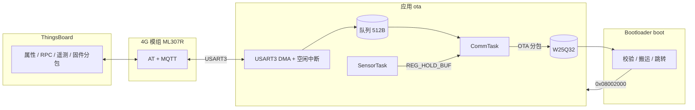
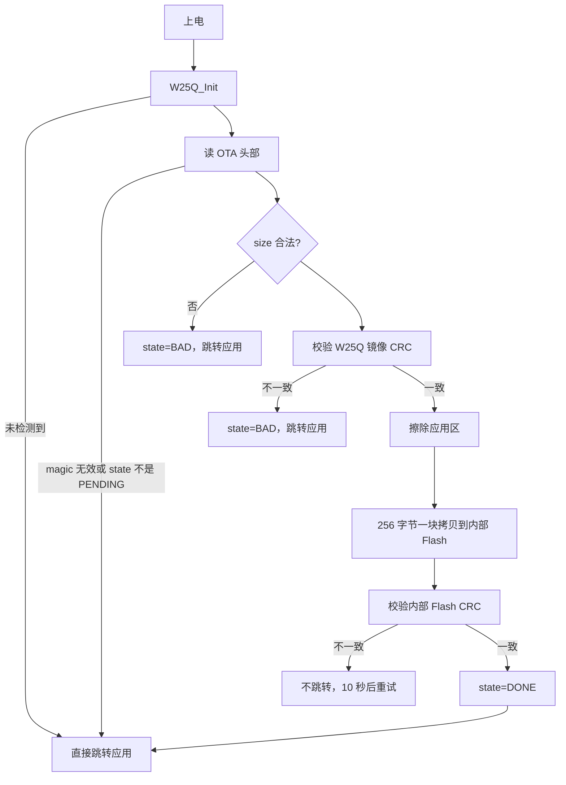
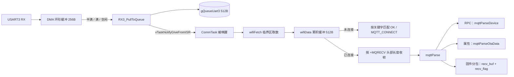
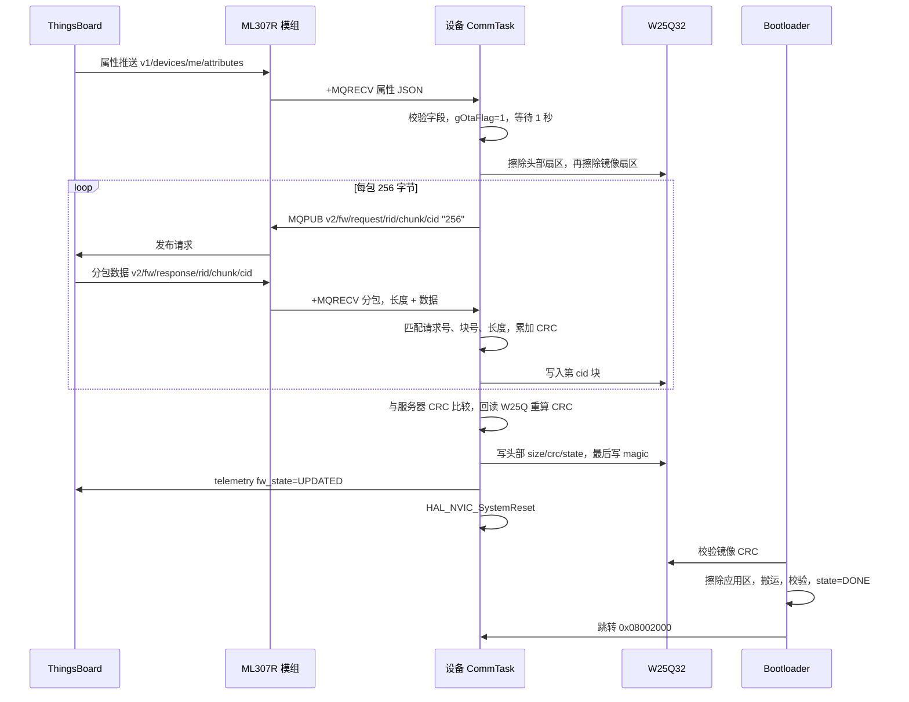

# STM32F103C8 4G OTA 工程：架构与设计

> 本文描述仓库根目录下两个同级 Keil 工程的整体架构、模块职责和设计决策：
> - `ota\`：应用（FreeRTOS、MQTT、OTA 下载）
> - `boot\`：Bootloader（校验、搬运、跳转）
>
> `docs\` 与两者同级。文中未加前缀的 `Core\`、`MDK-ARM\` 默认指应用工程（`ota\`）下的路径；Bootloader 路径一律写 `boot\...`。内存、时间数据是估算或某次编译的快照，以实际 map 文件和实测为准。

## 目录

1. 项目概述
2. 关键设计决策一览
3. 硬件资源与时钟
4. 存储布局与 OTA 头部
5. 软件架构与任务划分
6. Bootloader 设计
7. 应用启动与业务任务
8. 串口接收与 4G 模组通信
9. 同步、互斥与中断控制
10. MQTT 与云端协议
11. OTA 升级实现
12. 资源占用与时间预算
13. 调试与日志
14. 已知问题与风险
15. 目录结构

---

## 1. 项目概述

设备通过 4G 模组（ML307R）连接 ThingsBoard（MQTT），完成三件事：

1. **遥测上报**：每 5 秒上报温湿度、电压电流功率、电位器电压、CPU 温度。
2. **远程控制**：接收 RPC，控制 LED1、蜂鸣器、继电器，并回复状态。
3. **OTA 升级**：服务器推送固件信息后，设备分包下载固件到外部 W25Q32，校验通过后重启，由 Bootloader 搬运到内部 Flash 并跳转运行。

| 项目 | 说明 |
| --- | --- |
| MCU | STM32F103C8（64 KB Flash，20 KB RAM），HAL 库 |
| RTOS | FreeRTOS V10.3.1（原生 API，任务和互斥量静态创建，heap_4） |
| 4G 模组 | ML307R，USART3，AT 命令 + MQTT |
| 云平台 | ThingsBoard（属性、RPC、遥测、固件分包） |
| 外部存储 | W25Q32（SPI1），仅用作 OTA 暂存区 |
| 其他外设 | OLED、AHT20、INA226（I2C1）；ADC1；LED、蜂鸣器、继电器 |

工程关系：

- 两个 Keil 工程**各自独立编译、独立烧录**：Bootloader 在 `boot\`，应用在 `ota\`，文档在 `docs\`，三者同级。
- Bootloader 上电先运行，负责校验、搬运、跳转；应用运行 FreeRTOS，负责通信和传感器。
- `w25q.c`、`w25q.h` 在两个工程中是**同一份源码的两个副本**（`ota\Core\...` 与 `boot\Core\...`），修改时需要两边同步。

---

## 2. 关键设计决策一览

下表列出工程里影响全局的设计决策。每条的细节见后面标注的章节。

| 编号 | 决策 | 做法 | 理由 | 代价与约束 | 详见 |
| --- | --- | --- | --- | --- | --- |
| D1 | 外部 Flash 暂存，不做 A/B 分区 | 新固件先下载到 W25Q32，校验通过后再由 Bootloader 搬运到内部应用区 | 内部只有 64 KB，放不下两份 56 KB 的应用；下载过程不影响正在运行的旧程序 | 搬运时要擦除应用区；搬运中途断电依赖 `PENDING` 状态重搬运 | 4、6、11 |
| D2 | 两个工程独立 | Bootloader 固定 8 KB 在 `0x08000000`，应用在 `0x08002000` | 升级只覆盖应用区，引导程序不受影响 | `w25q.c` 两份副本、地址常量需两边一致 | 5.4 |
| D3 | 先校验后擦除，搬运后再校验 | Bootloader 先校验 W25Q 镜像 CRC，通过后才擦内部应用区；搬运完再算一次内部 Flash CRC | 镜像损坏时旧程序仍可运行；内部 CRC 兜底 Flash 写入错误 | 擦除后到搬运完成之前不能回退，只能重搬运 | 6.2 |
| D4 | 头部 `magic` 最后写，状态字靠 NOR 位特性 | 先写 size/crc/state，最后写 magic；状态只从 1 改成 0 | 断电安全；改状态不需要擦除 | 状态取值必须按位包含关系设计 | 4.4 |
| D5 | 先擦头部，再擦镜像 | 下载开始先擦除头部扇区，让旧头部失效 | 下载中途断电或重启，Bootloader 不会误升级 | 下载失败后旧固件不会被自动重新升级 | 11.4 |
| D6 | 时基分离 | HAL 用 TIM1 产生 `HAL_GetTick`，FreeRTOS 用 SysTick | 两者互不争用 | 临界区屏蔽 TIM1 时，`HAL_GetTick` 暂停 | 3.1、9.4 |
| D7 | DMA 环形接收 + 三种触发同一入队函数 | 半满、满、空闲三处都调用 `RX3_PullToQueue`，用 DMA 计数器算新增字节数 | 不依赖空闲中断判断帧尾；多次触发结果一致，不重复入队 | 中断延迟超过约 22 ms 时 DMA 静默覆盖 | 8.1、9.6 |
| D8 | 中断只入队，解析放在任务里 | ISR 只做入队和任务通知，帧解析在 `CommTask` | ISR 执行时间短，不阻塞其他中断 | 解析有最多约 10 ms 的延迟 | 8.2 |
| D9 | 单任务独占串口、W25Q、cJSON、`printf` | 这些资源只由 `CommTask` 使用 | 大部分共享数据不需要加锁 | `CommTask` 阻塞时（连接、擦写、OLED）不处理下行 | 5.3 |
| D10 | 累积缓冲 + 按长度收帧 | 数据先追加到 `wifiData`，`+MQRECV` 消息按头部声明的长度收齐 | 解决拆包和粘包；二进制载荷只能靠长度确定边界 | 单条消息不能超过 511 字节；残缺消息 500 ms 后丢弃 | 8.4、8.5 |
| D11 | 两种解析模式 | 未连接时按关键字匹配应答，已连接时按帧解析 | AT 应答是文本，MQTT 下行是带长度的二进制帧 | 切换模式的时机靠 `connected` 标志，需保证一致 | 8.4 |
| D12 | 任务通知代替二值信号量 | ISR 用 `vTaskNotifyGiveFromISR` 唤醒 `CommTask` | 不需要额外内核对象，开销最小 | 只能唤醒一个固定任务 | 9.2 |
| D13 | I2C1 用互斥量保护 | OLED、AHT20、INA226 访问前加 `I2C1_Lock` | 多个任务共用一条总线，事务不能被打断 | 持锁任务卡死时其他任务永久阻塞（`portMAX_DELAY`） | 9.3 |
| D14 | 传感器任务优先级高于通信任务 | `SensorTask` idle+2，`CommTask` idle+1 | `CommTask` 擦写 W25Q 时会忙等，传感器不能停更 | 通信任务在高负载时响应变慢 | 5.2 |
| D15 | 任务和互斥量静态创建 | 栈和控制块都是全局数组 | RAM 占用编译期可见，不依赖堆 | 任务数量固定 | 5.2、12 |
| D16 | 分包用 `request_id` + `chunk_id` + 长度匹配，单包超时重发 | 响应必须同时匹配请求号、块号、字节数 | 防止旧下载的包被误用；防止半包写入 Flash | 没有滑动窗口，每包都要一次往返 | 11.3 |
| D17 | 两层校验 | 与服务器 `fw_checksum` 比较，再回读 W25Q 重算 CRC | 传输错误和写入错误都能发现 | 下载结束后要多读一遍 W25Q | 11.5 |
| D18 | 应用不比较版本，不读 OTA 头部 | 收到完整的 `fw_*` 属性就下载 | 实现简单 | 服务器保留属性时会重复升级 | 14 |

---

## 3. 硬件资源与时钟

### 3.1 引脚与外设分配

| 外设 | 引脚 | 用途 | 备注 |
| --- | --- | --- | --- |
| USART1 | PA9（TX）/ PA10（RX） | 调试串口（`printf`） | 115200 8N1，阻塞发送，只发不收 |
| USART3 | PB10（TX）/ PB11（RX） | 4G 模组 | 115200 8N1，DMA 环形接收 + 空闲中断 |
| I2C1 | PB6（SCL）/ PB7（SDA） | OLED、AHT20、INA226 | 100 kHz，多任务共用，需加锁 |
| SPI1 | PA5（SCK）/ PA6（MISO）/ PA7（MOSI）/ PA4（CS，软件控制） | W25Q32 | 寄存器级驱动 |
| ADC1 | PA1（IN1）、内部温度传感器 | 电位器电压、CPU 温度 | 软件触发，单次转换 |
| GPIO | LED1=PB9、LED2=PB8、继电器=PB1、蜂鸣器=PC13 | 输出控制 | LED2 作心跳指示 |
| TIM1 | - | HAL 时基（`HAL_GetTick`） | 更新中断，优先级 15 |
| SysTick | - | FreeRTOS 节拍 | 由 FreeRTOS 移植层接管 |

### 3.2 时钟树

```text
HSE 8 MHz ──► PLL ×9 ──► SYSCLK 72 MHz ──► AHB /1  = HCLK  72 MHz（CPU、DMA、FreeRTOS 节拍）
                                     ├─► APB1 /2 = PCLK1 36 MHz（USART3、I2C1；定时器时钟 72 MHz）
                                     ├─► APB2 /1 = PCLK2 72 MHz（USART1、SPI1、ADC1、TIM1）
                                     └─► ADC 时钟 = PCLK2 /6 = 12 MHz
```

- 外部晶振 HSE 8 MHz（`HSE_VALUE = 8000000`），HSI 保持开启，PLL 倍频 ×9，系统时钟 72 MHz。
- Flash 等待周期 2（72 MHz 必须）。
- **时基分离**：SysTick 交给 FreeRTOS 做 1 ms 节拍（`configTICK_RATE_HZ = 1000`，`xPortSysTickHandler` 映射为 `SysTick_Handler`）；HAL 的 `HAL_GetTick()` 改用 **TIM1** 更新中断（`HAL_IncTick`），避免两者争用 SysTick。

### 3.3 外设配置

| 外设 | 关键配置 |
| --- | --- |
| **USART1**（调试） | 115200，8N1，无流控，16 倍过采样；`fputc` 重定向到 `HAL_UART_Transmit(&huart1, ..., HAL_MAX_DELAY)`，逐字符阻塞发送 |
| **USART3**（4G 模组） | 115200，8N1，无流控；发送用 `HAL_UART_Transmit`（阻塞，超时 1 s）；接收见 DMA 配置，另外使能空闲中断（`__HAL_UART_ENABLE_IT(huart3, UART_IT_IDLE)`） |
| **DMA1_Channel3**（USART3_RX） | 外设→内存，字节对齐，内存地址递增，外设地址不递增，**循环模式**，优先级 High；缓冲区 `RX3_Buf[256]`，`HAL_UART_Receive_DMA` 启动 |
| **I2C1** | 100 kHz，7 位地址，占空比 2，不使用中断，HAL 阻塞传输（超时 1000 ms） |
| **SPI1** | 见下方补充：`MX_SPI1_Init` 由 CubeMX 生成，但 `W25Q_Init` 会重新配置寄存器 |
| **ADC1** | 单通道、软件触发、单次转换、右对齐，采样时间 239.5 个周期；初始化后执行校准 |
| **GPIO** | 蜂鸣器、继电器推挽输出，初始低电平；LED1/LED2 初始高电平（低电平点亮，即初始熄灭）；W25Q 的 CS 初始高电平（不选中） |

补充说明：

- **SPI1 双重配置**：CubeMX 的 `MX_SPI1_Init` 使用 `/128` 分频，但 `W25Q_Init` 直接写 `SPI1->CR1`：主机模式、软件 NSS、模式 0（CPOL=0，CPHA=0）、8 位、MSB 在前、`/8` 分频（72 MHz → 9 MHz，W25Q 的 `0x03` 读指令最高支持 50 MHz）。
- **ADC 读取**（`ADC_VR_CPU_Read`）：先切到通道 1（电位器，PA1）转换 10 次取平均，再切到内部温度传感器转换 10 次取平均，用 `(1.43 - V) / 0.0043 + 25` 换算 CPU 温度。全程阻塞轮询，由 `SensorTask` 每 500 ms 调用一次。
- **输出极性**：LED 低电平点亮；蜂鸣器、继电器高电平动作。
- **USART1 阻塞发送的代价**：115200 下每字符约 87 µs，一行日志几毫秒到十几毫秒。它会拖慢调用 `printf` 的任务，但不影响中断收数据。

---

## 4. 存储布局与 OTA 头部

### 4.1 内部 Flash（64 KB）

```text
0x08000000 ┌──────────────────┐
           │ Bootloader  8 KB │  boot 工程
0x08002000 ├──────────────────┤
           │ 应用程序   56 KB │  应用工程，最大 0xE000 字节
0x08010000 └──────────────────┘
```

- 没有第二份应用区（没有 A/B 分区）：新固件先放在外部 W25Q，由 Bootloader 搬运到应用区。
- 应用区按 1 KB 页擦除（`FLASH_PAGE_SIZE`），一次升级要擦除全部需要的页。

### 4.2 启动地址与跳转

| 工程 | 起始地址 | 大小 | 依据 |
| --- | --- | --- | --- |
| Bootloader（boot） | **0x08000000** | 8 KB（到 0x08001FFF） | `boot\MDK-ARM\boot.uvprojx` 的 IROM1；`boot\Core\Inc\boot.h` 中 `BootLoader_Size = 0x2000` |
| 应用（ota） | **0x08002000** | 56 KB（到 0x0800FFFF） | `ota\MDK-ARM\ota.uvprojx` 的 IROM1；`ota\Core\Inc\boot.h` 中 `Application_1_Addr = 0x08002000U` |

- 应用的链接起点是 0x08002000，烧录的 `.bin` 也要从该地址开始写入，不是从 0 开始。
- 应用启动时，`Core\Src\main.c` 设置 `SCB->VTOR = FLASH_BASE | Application_1_Addr`，让中断向量表指向应用区。
- Bootloader 通过 `IAP_ExecuteApp(0x08002000)` 跳转：先检查 0x08002000 处的栈顶是否落在 RAM 区（`0x2FFE0000` 掩码后等于 `0x20000000`），再用它设置 MSP，然后跳到 0x08002004 处的复位向量。

### 4.3 外部 W25Q32 布局

```text
0x000000  扇区 0：OTA 头部 ota_hdr_t { magic, size, crc, state }
0x001000  固件镜像（最大 56 KB，即 Application_Size）
```

- 擦除单位 4 KB（`W25Q_SECTOR_SIZE`），固件区共 14 个扇区。

### 4.4 OTA 头部与状态机

| 偏移 | 字段 | 说明 |
| --- | --- | --- |
| 0x00 | `magic` | `0x3141544F`（"OTA1"），**最后写入**，有效即代表镜像完整 |
| 0x04 | `size` | 固件字节数 |
| 0x08 | `crc` | **标准** CRC32（zlib 多项式，不做字节交换） |
| 0x0C | `state` | 状态字，见下表 |

| 值 | 名称 | 含义 |
| --- | --- | --- |
| 0xFFFFFFFF | NONE | 擦除态，无升级 |
| 0xAAAAAAAA | PENDING | 下载完成，等待 Bootloader 搬运 |
| 0x00000000 | DONE | 搬运并校验成功 |
| 0x88888888 | BAD | 镜像损坏，不再尝试 |

**状态机利用 NOR Flash 只能把位从 1 写成 0 的特性**：`BAD`（0x88）和 `DONE`（0x00）都是 `PENDING`（0xAA）的位子集，Bootloader 改状态只需编程，不需要擦除扇区。

**一次升级中头部的变化**：

| 步骤 | 位置 | 动作 | 头部状态 |
| --- | --- | --- | --- |
| 下载开始 | `mqtt.c` 的 `MQTT_OTA_GetFW` | 先擦除 0x000000 扇区 | magic 失效，Bootloader 不会升级 |
| 下载校验通过 | `mqtt.c` | 先写 size、crc、state=PENDING（偏移 0x04，共 12 字节），**最后**写 magic | magic 有效，state=PENDING |
| 重启 | `HAL_NVIC_SystemReset()` | - | - |
| Bootloader 检查 | `boot.c` 的 `Ota_Update` | magic 有效且 state==PENDING 才升级，否则正常启动 | 不变 |
| 大小非法 / 镜像 CRC 不一致 | `boot.c` | state=BAD，跳转旧程序 | BAD |
| 读 W25Q 失败 | `boot.c` | 不改状态，跳转旧程序 | PENDING 保留 |
| 擦除并拷贝应用区 | `boot.c` 的 `CopyFromExt` | 擦除应用区，逐块拷贝 | PENDING |
| 搬运后内部 CRC 不一致 | `boot.c` | 返回 -1，不跳转，10 秒后重试 | PENDING 保留 |
| 搬运成功 | `boot.c` | `Ota_SetState(DONE)` | DONE |
| 之后每次启动 | `boot.c` | magic 有效但 state 不是 PENDING，正常启动 | DONE |

---

## 5. 软件架构与任务划分

### 5.1 总体结构



### 5.2 任务划分（`freertos.c`）

| 任务 | 优先级 | 栈 | 职责 |
| --- | --- | --- | --- |
| `CommTask` | idle+1 | 512 字（2 KB） | AT 命令、MQTT 连接、收包解析、遥测上报、掉线重连、OTA 下载 |
| `SensorTask` | idle+2 | 256 字（1 KB） | 每 500 ms 刷新传感器，每 20 ms 读取 AHT20 结果并刷新输出 |
| 空闲任务 | idle | 128 字（512 B） | 静态内存，`vApplicationGetIdleTaskMemory` 提供 |
| `defaultTask` | - | 128 字 | CubeMX 生成，启动后立即 `vTaskDelete(NULL)` 删除自己 |

- 任务和互斥量都用**静态内存**创建，RAM 占用在编译时可见，不依赖 FreeRTOS 堆。
- `SensorTask` 优先级高于 `CommTask`：`CommTask` 在 OTA 擦写 W25Q 时会忙等，不能让传感器数据停更。

### 5.3 资源归属

| 资源 | 归属 | 是否加锁 | 说明 |
| --- | --- | --- | --- |
| USART3（4G 模组）发送 | `CommTask` | 否 | 只有一个任务发送 |
| `wifiData` / `wifiLen`（累积缓冲） | `CommTask` | 否 | 只有一个任务访问 |
| W25Q32 / SPI1 | `CommTask` | 否 | OTA 下载与擦写都在通信任务里 |
| cJSON 与 libc 堆 | `CommTask` | 否 | cJSON 解析只在通信任务中调用 |
| `printf`（USART1） | `CommTask` 为主 | 否 | `SensorTask` 不打印；HardFault 只在异常时打印 |
| I2C1（OLED、AHT20、INA226） | 两个任务共用 | **是**（互斥量） | 见 9.3 |
| ADC1、GPIO 输出（LED、蜂鸣器、继电器） | `SensorTask` | 否 | 控制位由 RPC 写入 `REG_HOLD_BUF[0]`，`SensorTask` 读取后输出 |

### 5.4 两个工程的边界

- `w25q.c` / `w25q.h` 是**同一份源码的两个副本**（`ota\Core\Src\w25q.c` 与 `boot\Core\Src\w25q.c`），改一处必须改另一处。
- 分区地址、`Application_Size` 等常量在两边的 `boot.h` 中都有定义，修改分区时两边同步，并同步修改各自 Keil 工程的 IROM1 起始地址和大小。

---

## 6. Bootloader 设计

### 6.1 启动流程



### 6.2 关键设计

- **先校验后擦除**：先校验 W25Q 中镜像的 CRC，通过后才擦除内部应用区。镜像损坏时旧程序仍然可用。
- **搬运后再校验**：拷贝完成后对内部 Flash 做一次 CRC。这一步同时兜底 Flash 编程错误，因为 `HAL_FLASHEx_Erase` 和 `HAL_FLASH_Program` 的返回值没有检查。
- **断电安全**：`magic` 在镜像完整后才写，搬运过程中掉电，`state` 仍是 `PENDING`，下次上电重新校验和搬运。
- **搬运失败不跳转**：内部应用区已被擦除，不能跳转。`main` 每 10 秒（`HAL_Delay(10 s)`）调用一次 `Start_BootLoader` 重试。
- **跳转前检查**：栈顶地址合法才跳转（`IAP_ExecuteApp`）；跳转前调用 `W25Q_DeInit()` 关闭 SPI1，CS 保持高电平。
- **CRC 一致**：Bootloader 与应用使用同一个 CRC32 实现（zlib 多项式 `0xEDB88320`）。

### 6.3 故障恢复矩阵

| 情况 | 处理结果 | 设备状态 |
| --- | --- | --- |
| W25Q 不在线 | 跳过升级，正常启动旧程序 | 不变 |
| 头部 magic 无效或 state≠PENDING | 正常启动 | 不变 |
| 头部 size 非法 | state=BAD，启动旧程序 | BAD |
| W25Q 镜像 CRC 不一致 | state=BAD，启动旧程序 | BAD |
| 读 W25Q 失败（校验前） | 不改状态，启动旧程序 | PENDING 保留，下次重试 |
| 搬运中（应用区已擦除）读 W25Q 失败 | 不跳转，10 秒后重试 | PENDING 保留 |
| 搬运中掉电 | 下次上电重新搬运 | PENDING 保留 |
| 搬运后内部 CRC 不一致 | 不跳转，10 秒后重试 | PENDING 保留 |

### 6.4 Bootloader 的资源

- 纯裸机顺序执行，没有 RTOS，没有使用外设中断。
- 唯一的中断是 `SysTick_Handler`（HAL 默认节拍，给 `HAL_Delay` 和 Flash、W25Q 超时提供时基）。
- `HAL_FLASH_Unlock()` / `HAL_FLASH_Lock()` 是 Flash 控制寄存器的写保护，每次擦除或编程前后成对调用，不是线程或中断锁。
- 跳转前没有关 SysTick 或关中断，这一点由应用开头兜底（见 7.1 和 14 章）。

---

## 7. 应用启动与业务任务

### 7.1 启动顺序（`main.c`）

1. **清理 Bootloader 遗留的 SysTick**：`SysTick->CTRL = 0`、`SysTick->VAL = 0`、`SCB->ICSR = PENDSTCLR`。Bootloader 跳转前没有关 SysTick，若调度器启动前进入它的中断，会访问未初始化的任务链表而 HardFault（见 P1 排查）。
2. 设置 `SCB->VTOR = 0x08002000`，中断向量表指向应用区。
3. `HAL_Init`，`SystemClock_Config`，初始化 GPIO、DMA、USART1、USART3、I2C1、ADC1、SPI1。
4. 初始化 OLED、AHT20、INA226、W25Q。
5. **初始化接收队列 → 打开 USART3 空闲中断 → 启动 DMA 环形接收**。顺序不能颠倒：中断一来就会访问队列。
6. `MX_FREERTOS_Init()` 创建互斥量和两个业务任务，`osKernelStart()` 启动调度器。

调度器启动后，`main` 的 `while(1)` 不会再执行，所有业务都在任务中。

### 7.2 `CommTask` 主循环

```text
mqttConnect()                       // 最长阻塞 180 秒，只阻塞本任务
loop:
    wifiWaitRx(10 ms)               // 等串口中断通知，最多 10 ms
    wifiPoll()                      // 取队列 → 累积 → 按帧解析
    每 5 s 且已连接 → 上报遥测
    已连接且连续 ERROR >= 3 → 判定掉线，OLED 显示 --
    掉线后每 60 s 重连一次
    收到 OTA 信息（gOtaFlag）→ 记录时刻 → 等 1 s → MQTT_OTA_GetFW()
```

- 等待期间 `wifiWaitRx` 阻塞，不占 CPU；有数据时立即返回，所以收数据的延迟远小于 10 ms。
- OTA 等待的 1 s 期间照常收数据，不会因为"等待"而丢掉服务器的下行消息。

### 7.3 传感器与寄存器表（`modbus.c`）

传感器任务把数据写入保持寄存器数组 `REG_HOLD_BUF`，通信任务读取后上报；RPC 写入控制位，传感器任务按位刷新输出。

| 寄存器 | 含义 | 来源 |
| --- | --- | --- |
| `[0]` | 控制位：bit0=LED1，bit2=蜂鸣器，bit3=继电器 | RPC 写入 |
| `[1]` | 温度 ×100 | AHT20 |
| `[2]` | 湿度 ×100 | AHT20 |
| `[3]` | 电压 ×100 | INA226 |
| `[4]` | 电流 | INA226 |
| `[5]` | 功率 | INA226 |
| `[6]` | 电位器电压 ×100 | ADC |
| `[7]` | CPU 温度 ×100 | ADC |

- `Modbus_Refresh`（每 500 ms）：加 I2C 锁，触发 AHT20 测量并读 INA226，解锁；读 ADC；翻转 LED2 作心跳。
- `Modbus_Parse`（每 20 ms）：加 I2C 锁，读取 AHT20 已完成的测量结果，解锁；按 `REG_HOLD_BUF[0]` 刷新 LED1、蜂鸣器、继电器。
- AHT20 是"触发测量 → 稍后读结果"两步式，测量结果由 20 ms 一次的 `Modbus_Parse` 取回，所以 I2C 事务都很短，不会长时间占锁。
- `REG_HOLD_BUF[0]` 只在 `CommTask` 里读改写，`SensorTask` 只读，因此不会出现两个任务同时改位丢失的问题。

---

## 8. 串口接收与 4G 模组通信

### 8.1 数据缓冲与时间预算

USART3 为 115200 8N1，每字节 10 位，约 **11.5 字节/毫秒**。三级缓冲的容量与溢出后果：

| 层级 | 容量 | 填满所需时间（最大速率） | 溢出后果 |
| --- | --- | --- | --- |
| DMA 环形缓冲 `RX3_Buf` | 256 B | 约 22 ms 绕一圈 | 若中断迟于 22 ms 才搬走数据，DMA 会**静默覆盖**，不计入任何计数器 |
| 中断触发间隔 | 半满 128 B | 约 11 ms 一次中断 | 半满、满中断保证大约每 11 ms 把数据搬走一次 |
| 入队队列 `gQueueUart3` | 512 B（可用 511） | 约 44 ms | 入队失败的字节丢弃，计入 `gRx3DropCnt` |
| 累积缓冲 `wifiData` | 512 B（可用 511） | 不计时间，取决于任务处理速度 | 连接阶段文本超长时强制统计并截断；帧超长时丢弃 |

**时间预算的含义**：只要 `CommTask` 能在约 44 ms 内取走一次队列，就不会丢数据。`CommTask` 的阻塞点有：`printf`、OLED 刷新、W25Q 擦写（每个扇区擦除可达几十毫秒）。擦除期间若服务器恰好有下行消息，可能超过队列容量，因此擦除循环里每擦一个扇区调用一次 `wifiPoll()`。

### 8.2 下行数据流



数据流分三步：

1. **硬件接收**：字节由 DMA 持续搬运到 256 字节环形缓冲，不占用 CPU。
2. **入队（中断）**：半满、满、空闲三处都调用同一个函数 `RX3_PullToQueue`。它用 DMA 计数器算出"已写入、还没入队"的字节数，逐字节放入队列，然后唤醒 `CommTask`。三种触发的结果一致，不依赖中断先后顺序，也不会重复入队。环形缓冲可能跨过末尾，所以逐字节取模，不整段拷贝。
3. **取数（任务）**：`CommTask` 醒来后调用 `wifiPoll()`。`wifiFetch()` 在临界区内把队列数据追加到 `wifiData`（只做内存拷贝），然后按当前模式解析。

### 8.3 模组连接状态机

```mermaid
stateDiagram-v2
    [*] --> 命令阶段: 上电，mqttConnect
    命令阶段 --> 命令阶段: AT 配置命令（OK / ERROR / 超时）
    命令阶段 --> 已连接: AT+REST 后收到 MQTT_CONNECT:
    命令阶段 --> 未连接: AT+REST 超时或 ERROR
    已连接 --> 未连接: 连续 3 次 ERROR，判定掉线
    未连接 --> 命令阶段: 每 60 秒重新 mqttConnect
```

连接时的 AT 序列（每条都用 `wifiCheckCmdStatus` 发送，发送前清空队列和累积缓冲）：

| 步骤 | 命令 | 等待的应答 | 超时 |
| --- | --- | --- | --- |
| 1 | `AT+MQMULTEN=1` | `OK\r\n` | 1 s |
| 2 | `AT+MQTTFILTER=0` | `OK\r\n` | 1 s |
| 3 | `AT+MQSUBM=0,1,0,4,"v1/devices/me/rpc/request/+"` | `OK\r\n` | 1 s |
| 4 | `AT+MQSUBM=1,1,0,4,"v1/devices/me/attributes"` | `OK\r\n` | 1 s |
| 5 | `AT+MQSUBM=2,1,0,4,"v2/fw/response/+/chunk/#"` | `OK\r\n` | 1 s |
| 6 | `AT+REST`（复位模组，自动重连） | `MQTT_CONNECT:` | 180 s |

- 任何步骤收到 `ERROR\r\n`，`mqttConnect` 立即返回失败。
- **注意**：前 5 步超时（`TIMEOUT`）不会中止流程，只有 `ERROR` 会。最终是否连接成功只由第 6 步决定（见 14 章）。
- 每次 `mqttConnect` 都会重新订阅三个主题，因为模组重启后订阅关系会丢失。

### 8.4 两种解析模式

由 `gWifi4G.connected` 切换，两种模式使用的数据形式完全不同：

| 项目 | 命令阶段（未连接） | 连接阶段（已连接） |
| --- | --- | --- |
| 输入 | AT 命令的文本应答 | `+MQRECV` 下行消息（二进制载荷）+ 文本应答 |
| 判断依据 | 关键字：`respKeyWord`（`OK\r\n` 或 `MQTT_CONNECT:`）、`ERROR\r\n` | 头部长度：`+MQRECV,[通道,]主题,载荷长度,` |
| 为什么这样判断 | 应答短，关键字唯一，不需要帧边界 | 载荷可能含 `0x00`、`\r\n`、`OK`，只能靠长度确定边界 |
| 匹配到之后 | 清空累积缓冲（丢弃之后的所有数据） | 只交出这一条消息，剩余数据前移 |
| 原始数据 | 同时打印到 USART1，便于调试 | 不打印 |
| 文本统计 | 不统计 | `OK` 清零 `errCount`，`ERROR` 加一（文本空闲 10 ms 后统计） |
| 超时保护 | 缓冲满时只保留末尾 32 字节，防止关键字跨边界丢失 | 残缺消息等待 500 ms，超时丢弃 |

### 8.5 帧解析规则（连接阶段）

`wifiParseConnected()` 在 `wifiData` 上循环处理：

1. 找 `+MQRECV,`。找不到时，只把末尾可能是标记前缀的字节（最多 7 个）留下，其余按文本统计并丢弃；文本空闲不足 10 ms 时先不处理。
2. 标记前面的文本先统计并丢弃，然后继续。
3. 标记在开头时，`wifiFrameLen()` 解析头部：
   - 可选通道号：一位数字加逗号（如 `1,`）；
   - 主题：直到下一个逗号；
   - 载荷长度：最多 4 位十进制数字，之后必须是逗号。
   头部格式错误（超过 4 位、没有逗号）时只跳过 8 字节的 `+MQRECV,` 标记，继续找下一条。
4. 头部完整，但整条消息（含头部）超过 511 字节：格式错误，跳过标记。
5. 收齐一整条：临时在末尾放 `\0`，把这一条交给 `mqttParse()`，然后只删掉这一条，剩余数据前移（`wifiShift`），循环继续。
6. 没收齐：等待；距离最近一次收到数据超过 500 ms 则整段丢弃，避免一直占住缓冲区。

**一次取数可能包含多条消息**，`while` 循环会依次处理完所有完整帧。残缺的尾部保留到下次取数后继续拼接。

### 8.6 上行（发送）

所有上行都由 `CommTask` 通过 `HAL_UART_Transmit(&huart3, ...)` 阻塞发送，格式为 `MQPUB,<通道>,<主题>,<载荷>`。

| 上行内容 | 触发 | 发送函数 | 是否等应答 |
| --- | --- | --- | --- |
| 遥测 | `CommTask` 每 5 秒（已连接时） | `mqttSendData(PUB1, 1, 0)` | 否 |
| RPC 应答 | 收到 RPC 后，在解析函数中 | `mqttSendData(PUB2, id, value)` | 否 |
| OTA 状态 | 升级成功或最终失败时 | `mqttSendData(PUB1, 2 / 3, 0)` | 否 |
| 固件分包请求 | OTA 下载循环 | `mqttSendOtaReq("256")` | 是，由接收循环等待（11.3） |
| AT 命令 | 仅连接阶段 | `wifiCheckCmdStatus` | 是，等关键字、`ERROR` 或超时 |

- 已连接阶段，遥测和 RPC 应答发完即走，不等待具体应答。成功与否通过连续 `ERROR` 计数间接判断。
- 发送与接收互不干扰：接收由 DMA 完成，发送是独立的 TX 通道，发送期间 DMA 仍在收数据。

### 8.7 错误统计与掉线判定

| 计数器 | 来源 | 含义 |
| --- | --- | --- |
| `gRx3FeCnt` | USART3 中断，读 SR 的 FE 位 | 帧错误（波特率或线路问题） |
| `gRx3NeCnt` | USART3 中断，读 SR 的 NE 位 | 噪声错误 |
| `gRx3OreCnt` | USART3 中断，读 SR 的 ORE 位 | 溢出（CPU 没及时读 DR） |
| `gRx3DropCnt` | `RX3_PullToQueue` | 队列满，丢弃的字节数 |
| `gWifi4G.errCount` | 连接阶段的文本统计 | 连续收到 `ERROR` 的次数，收到 `OK` 清零 |

- 错误计数只能说明**发生了多少次**，不能说明具体丢了哪些字节。
- DMA 环形缓冲被覆盖不会触发 ORE，所以**没有任何计数器能统计这种丢失**（见 14 章）。
- OTA 下载开始和结束时各记录一次，结束时打印本次下载期间的增量（`drop=` 等）。

---

## 9. 同步、互斥与中断控制

### 9.1 数据归属总览

| 数据 | 谁写 | 谁读 | 保护方式 |
| --- | --- | --- | --- |
| DMA 环形缓冲 `RX3_Buf`、`RX3_Offset` | DMA 硬件、USART3/DMA 中断 | `RX3_PullToQueue` | 两个中断优先级相同（5），不互相嵌套 |
| 接收队列 `gQueueUart3` | 中断（入队） | `CommTask`（出队） | 出队在 `taskENTER_CRITICAL` 内 |
| 累积缓冲 `wifiData`、`wifiLen` | `CommTask` | `CommTask` | 单任务访问，不需要锁 |
| 解析结果 `OTA_Info.recv_buf`、`recv_flag`、`gOtaFlag`、`connected` | `CommTask`（解析函数中） | `CommTask` | 单任务，但 `recv_buf` 有复用风险（14 章） |
| `REG_HOLD_BUF[1..7]` | `SensorTask` | `CommTask` | 单次 16 位读写，未加锁，遥测可接受采样抖动 |
| `REG_HOLD_BUF[0]`（控制位） | `CommTask` 读改写 | `SensorTask` 只读 | 单写者，不会丢位 |
| I2C1 总线 | OLED、AHT20、INA226 驱动 | 同左 | 互斥量（9.3） |
| `gRx3*Cnt`、`rxPending`、`gOtaFlag` 等标志 | 单一写者（ISR 或任务） | 另一方 | `__IO`（`volatile`），单次赋值，不是锁 |

### 9.2 同步与互斥原语

工程中实际使用的同步手段只有下表这几种：

| 手段 | 位置 | 作用 | 说明 |
| --- | --- | --- | --- |
| 任务通知（Task Notification） | `wifi4g.c` 的 `wifiRxNotifyFromISR`（ISR）、`wifiWaitRx`（任务） | ISR 唤醒 `CommTask` | 代替二值信号量。`ulTaskNotifyTake(pdTRUE, ...)` 取走后清零，超时返回 |
| 互斥量（Mutex） | `i2c.c` 的 `i2c1Mutex` | 保护 I2C1 总线 | 静态创建，支持优先级继承 |
| 临界区（`taskENTER_CRITICAL`） | `wifi4g.c` 的 `wifiFetch`、`wifiFlush` | 保护队列的读指针和 `rxPending` | `BASEPRI = 5`，屏蔽优先级数值 ≥ 5 的中断 |
| 环形队列 `sequeue_t` | `fifo.c`，`gQueueUart3` | 中断到任务的数据通道 | 不是 FreeRTOS 对象，是自研的单生产者单消费者环形缓冲 |
| `volatile` 标志位 | `gOtaFlag`、`rxPending`、`gWifi4G` 各字段、`gRx3*Cnt` | 状态通知 | 单写者，不是锁 |
| 任务延时（`vTaskDelay`） | `SensorTask` | 周期让出 CPU | 定时手段，不是同步原语 |
| `taskDISABLE_INTERRUPTS` | `FreeRTOSConfig.h` 的 `configASSERT` | 断言失败时停机 | 只用于断言 |
| `__disable_irq`（PRIMASK） | 两个工程的 `Error_Handler` | 致命错误停机 | 之后死循环，不恢复 |

**"队列"一词的两种含义**：工程里的消息通道是自研环形队列 `gQueueUart3`，它不是 FreeRTOS 的 `xQueue`。两者不要混淆。

### 9.3 I2C1 互斥

OLED、AHT20、INA226 共用 I2C1，分属两个任务：`CommTask` 在 OTA 进度显示中刷新 OLED，`SensorTask` 读传感器。`SensorTask` 优先级更高，会在 `CommTask` 做 OLED 传输时抢占，导致一次 I2C 事务被打断。因此访问总线前必须拿 `I2C1_Lock()`。

| 加锁位置 | 保护的操作 |
| --- | --- |
| `oled.c` `OLED_Fill` | 全屏填充（清屏） |
| `oled.c` `OLED_ShowStr` | 字符串显示（菜单、OTA 进度） |
| `modbus.c` `Modbus_Refresh` | 触发 AHT20 测量，读 INA226 |
| `modbus.c` `Modbus_Parse` | 读取 AHT20 结果 |

- 锁的粒度是一整段操作，不是单次字节传输。
- 调度器启动前只有一个执行流，`I2C1_Lock` 会检查 `xTaskGetSchedulerState() == taskSCHEDULER_RUNNING`，未启动时直接跳过加锁。
- 使用 `portMAX_DELAY` 永久等待：持锁任务卡死时，其他任务也会永久阻塞。

### 9.4 临界区与开关中断

| 阶段 | 场景 | 动作 | 屏蔽范围 | 目的与注意 |
| --- | --- | --- | --- | --- |
| 启动 | `HAL_InitTick`（`stm32f1xx_hal_timebase_tim.c`） | 启动 TIM1，使能 `TIM1_UP_IRQn`，优先级 15 | 开 TIM1 更新中断 | 给 `HAL_GetTick`、`HAL_Delay` 和所有 HAL 超时提供 1 ms 时基 |
| 启动 | `MX_DMA_Init` | 使能 `DMA1_Channel3_IRQn`，优先级 5 | 开 DMA 中断 | 半满、满中断负责把数据搬进队列 |
| 启动 | `MX_USART3_UART_Init` → `HAL_UART_MspInit` | 使能 `USART3_IRQn`，优先级 5 | 开 USART3 中断 | 空闲中断和错误中断 |
| 启动 | `main()` 接收启动顺序 | `Queue_Init` → `__HAL_UART_ENABLE_IT(IDLE)` → `HAL_UART_Receive_DMA` | 开启空闲中断源，再启动 DMA | 队列必须先就绪，否则中断一来就操作未初始化的队列 |
| 启动交接 | `main()` 开头 | 关 SysTick，清挂起位，设置 `SCB->VTOR` | 关 SysTick | 防止 Bootloader 遗留的 SysTick 在调度器启动前触发（P1） |
| 启动 | `osKernelStart()` | FreeRTOS 内部关中断、配置 SysTick 和 PendSV，`svc 0` 启动第一个任务 | 内核内部 | 调度器启动过程中不会发生节拍中断或任务切换 |
| 运行 | `wifiFetch` | `taskENTER_CRITICAL` … `taskEXIT_CRITICAL` | `BASEPRI = 5` | 出队时不能被入队打断，否则 `front/rear` 不一致 |
| 运行 | `wifiFlush` | 同上 | 同上 | 清空队列和 `rxPending` 时不能被并发入队 |
| 运行 | FreeRTOS API 内部 | 就绪链表、延时链表、互斥量状态的操作 | 内核内部 | 应用代码不需要关心 |
| 运行（中断内） | `USER_UART_IRQHandler` 的 FE/NE 分支 | `HAL_UART_DMAStop` → `RX3_Offset = 0` → `HAL_UART_Receive_DMA` | ISR 内停止并重启 DMA | 帧错误后先把已收数据入队，再让 DMA 从缓冲区起点重新开始 |
| 停机 | `configASSERT` 失败 | 先打印 `[ASSERT] 文件:行号`，再 `taskDISABLE_INTERRUPTS()` 死循环 | `BASEPRI = 5` | 停在现场，便于定位 |
| 停机 | `Error_Handler` | `__disable_irq()` 死循环 | `PRIMASK = 1`，全部可屏蔽中断关闭 | 外设初始化失败等不可恢复错误 |

**临界区的约束**：

- 临界区内只做内存拷贝，不能调用 `printf`、`HAL_UART_Transmit`、`HAL_Delay`，也不能调用会阻塞的 FreeRTOS API。
- 原因：`BASEPRI = 5` 会把 TIM1（`HAL_GetTick` 的时基）和 SysTick 一起屏蔽，临界区内 tick 不走，依赖超时的函数会失效或卡住。
- 临界区只屏蔽优先级数值 ≥ 5 的中断。SVCall（0）等更高优先级中断不受影响，因此这些中断里不能调用 `FromISR` API。
- 临界区要尽量短：期间 USART3 和 DMA 的中断请求挂起，DMA 环形缓冲约 22 ms 写满一圈。

### 9.5 中断优先级

NVIC 分组为 `NVIC_PRIORITYGROUP_4`（4 位全部是抢占优先级，无子优先级）。**数值越小优先级越高**。

| 中断 | 优先级 | 是否能调用 FromISR API | 说明 |
| --- | --- | --- | --- |
| SVCall | 0 | 否 | 启动调度器时执行一次 |
| USART3 | 5 | 是 | 空闲、错误统计 |
| DMA1_Channel3（USART3 RX） | 5 | 是 | 半满、满中断 |
| PendSV | 15 | - | 任务切换 |
| SysTick | 15 | - | FreeRTOS 节拍 |
| TIM1_UP | 15 | - | HAL 时基（`TICK_INT_PRIORITY = 15`） |

FreeRTOS 相关配置：`configLIBRARY_MAX_SYSCALL_INTERRUPT_PRIORITY = 5`，`configKERNEL_INTERRUPT_PRIORITY = 15`。

**约束**：

- 中断里要调用 `FromISR` API，优先级数值必须 ≥ 5。
- `taskENTER_CRITICAL` 只屏蔽数值 ≥ 5 的中断，所以 USART3 和 DMA（正好是 5）能被临界区保护，且互不嵌套。
- **不要把这两个中断的优先级数值改小**，否则它们不能调用 `FromISR` API，也不会被临界区屏蔽。

### 9.6 中断服务函数

应用共使用 7 个中断入口（含内核异常和 HardFault），Bootloader 只有 SysTick：

| 中断 | 处理函数 | 优先级 | 触发源 | 函数里做了什么 | 注意 |
| --- | --- | --- | --- | --- | --- |
| SysTick | `SysTick_Handler`（= `xPortSysTickHandler`） | 15 | 每 1 ms | FreeRTOS 节拍，`xTaskIncrementTick()`，需要时挂起 PendSV | 调度器启动前不能触发（P1） |
| PendSV | `PendSV_Handler` | 15 | 任务切换请求 | 保存当前上下文，恢复最高优先级就绪任务 | 其他中断处理完才执行 |
| SVCall | `SVC_Handler` | 0 | 启动时一次 | 加载第一个任务的上下文 | 之后不再触发 |
| TIM1 更新 | `TIM1_UP_IRQHandler` | 15 | 每 1 ms | `HAL_TIM_PeriodElapsedCallback` → `HAL_IncTick()` | 临界区内被屏蔽，tick 暂停 |
| DMA1 通道 3 | `DMA1_Channel3_IRQHandler` | 5 | 每 128 字节半满、每 256 字节满、传输错误 | 半满、满回调都调用 `RX3_PullToQueue()` | 与 USART3 同优先级，不互相嵌套 |
| USART3 | `USART3_IRQHandler` | 5 | 空闲、FE、NE、ORE | ① 读 SR 累加错误计数（必须在 HAL 清标志之前）；② `HAL_UART_IRQHandler`；③ `USER_UART_IRQHandler`：FE/NE 分支重启 DMA；空闲分支调用 `RX3_PullToQueue` | `lastIdleTick` 只写不读，是遗留 |
| HardFault | `HardFault_Handler` | 固定最高 | 非法访问、栈溢出等 | 打印 `CFSR/HFSR/BFAR` 和出错任务名，然后死循环 | 只用于调试；其他故障处理函数只是死循环，不输出 |

**`RX3_PullToQueue()` 的三步**（半满、满、空闲、FE/NE 都调用它）：

1. 用 DMA 计数器算出写位置 `pos = (256 - NDTR) % 256`，新数据长度 `len = (pos + 256 - RX3_Offset) % 256`；`len == 0` 直接返回。
2. 逐字节 `Enqueue(RX3_Buf[(RX3_Offset + k) % 256])`；队列满时丢弃并 `gRx3DropCnt++`。
3. `RX3_Offset = pos`，`rxPending = 1`，调用 `wifiRxNotifyFromISR()`（`vTaskNotifyGiveFromISR` + `portYIELD_FROM_ISR`）唤醒 `CommTask`。

**ISR 的约束**：

- 不阻塞，不调用 `printf`（HardFault 例外），只使用 `FromISR` 形式的 FreeRTOS API。
- 只往队列写，改计数器和 `rxPending`，不碰 `wifiData`。
- 耗时与新增字节数成正比，一次最多一圈（256 字节）。USART3 和 DMA 的优先级（5）高于 TIM1 和 SysTick（15），ISR 变长会推迟 tick 和任务切换。

### 9.7 无锁共享的理由

| 对象 | 访问方 | 为什么不需要锁 |
| --- | --- | --- |
| `RX3_Buf`、`RX3_Offset` | USART3 ISR 与 DMA1_Ch3 ISR | 两者优先级相同（5），不会互相抢占，`RX3_PullToQueue` 天然串行 |
| `sequeue_t` 的 `front` / `rear` | ISR（`Enqueue`）与 `CommTask`（`Dequeue`） | 单生产者（ISR 写 `rear`）、单消费者（任务写 `front`）。`volatile` 只防止编译器缓存，**不保证原子性**，真正的互斥靠消费端临界区屏蔽生产端 ISR |
| `REG_HOLD_BUF[1..7]` | `SensorTask` 写，`CommTask` 读 | Cortex-M3 上对齐的 16 位读写是原子的；遥测读多个寄存器时可能跨一次刷新，属于可接受的采样抖动 |
| `REG_HOLD_BUF[0]` | `CommTask` 读改写，`SensorTask` 只读 | 单写者，不会丢位 |
| `gOtaFlag`、`gWifi4G` 各字段、`gRx3*Cnt` | 单写者 + 单读者 | 声明为 `__IO`，32 位和 8 位单次赋值在 Cortex-M3 上原子完成 |

---

## 10. MQTT 与云端协议

### 10.1 主题

| 方向 | 主题 | 用途 |
| --- | --- | --- |
| 下行 | `v1/devices/me/rpc/request/+` | 控制命令（`+` 为请求号） |
| 下行 | `v1/devices/me/attributes` | OTA 固件信息（`fw_*` 属性） |
| 下行 | `v2/fw/response/<rid>/chunk/<cid>` | 固件分包内容 |
| 上行 | `v1/devices/me/telemetry` | 遥测、OTA 状态 |
| 上行 | `v1/devices/me/rpc/response/<id>` | RPC 应答 |
| 上行 | `v2/fw/request/<rid>/chunk/<cid>` | 请求固件分包，载荷为字节数 `"256"` |

### 10.2 RPC 命令

| 方法 | 参数 | 动作 | 应答 |
| --- | --- | --- | --- |
| `led1Status` | - | 读 LED1 引脚状态 | 当前状态 `true` / `false` |
| `beepStatus` | - | 读蜂鸣器引脚状态 | 同上 |
| `relayStatus` | - | 读继电器引脚状态 | 同上 |
| `led1Set` | `params`：0 或 1 | 置位或清零 `REG_HOLD_BUF[0]` 对应位 | 设置后的状态 `true` / `false` |
| `beepSet` | 同上 | 同上（bit2） | 同上 |
| `relaySet` | 同上 | 同上（bit3） | 同上 |

- RPC 的 `id` 从主题后缀取出（`strtol`），应答主题为 `v1/devices/me/rpc/response/<id>`。
- 控制位由 `CommTask` 写入，`SensorTask` 在下一次 `Modbus_Parse`（约 20 ms 内）刷新输出引脚。
- `params` 之外的值（非 0 也非 1）会被忽略，不回复。

### 10.3 上行遥测与 OTA 状态

- **遥测**：每 5 秒一次，格式 `MQPUB,1,v1/devices/me/telemetry,{TP:..,RH:..,VO:..,CU:..,PW:..,VR:..,CPU:..}`。键名没有加引号，不是严格 JSON，依赖 ThingsBoard 的宽松解析（14 章）。
- **OTA 状态**：升级成功上报 `{"fw_state":"UPDATED"}`，最终失败上报 `{"fw_state":"FAILED"}`。

### 10.4 掉线判定与重连

- 已连接状态下连续收到 3 次 `ERROR`（`MQTT_ERR_LIMIT`）判定掉线，OLED 显示 `--`，`connected` 清零。
- 之后每 60 秒（`MQTT_RECONNECT_MS`）重新执行一次 `mqttConnect`。
- 收到 `OK` 会把 `errCount` 清零，所以偶发的 `ERROR` 不会累计成掉线。

---

## 11. OTA 升级实现

### 11.1 总体思路

1. **云端推属性**：ThingsBoard 为设备分配固件后，通过属性推送固件信息（不含固件内容）。
2. **设备分包下载到外部 W25Q**：不动内部应用区，下载和校验全部在外部 Flash 上完成。
3. **写头部、重启**：校验通过后写入头部（标记待升级），复位。
4. **Bootloader 搬运**：上电后发现待升级标记，校验、擦除应用区、拷贝、再校验，然后跳转新固件。

### 11.2 整体时序



### 11.3 下发阶段：接收并校验属性

`mqttParse` 依次检查 RPC 主题、属性主题、分包主题。属性主题命中后：

1. `mqttValue` 找到 `v1/devices/me/attributes`，从第一个 `{` 开始按括号配对取出完整 JSON（支持嵌套），拷贝到 `OTA_Info.recv_buf`。
2. `mqttParseOtaData` 用 cJSON 解析，检查：
   - `fw_title`、`fw_version`、`fw_checksum` 是字符串，`fw_size` 是数字，四个字段齐全；
   - `fw_size` 在 1 ~ `Application_Size`（56 KB）之间；
   - `fw_checksum` 不超过 8 位，且全部是十六进制字符。
3. 校验通过：保存信息，`ota_try = 0`，`gOtaFlag = 1`。校验不通过：忽略，不改变任何状态（例如 `{"deleted":["fw_url"]}` 直接忽略）。

`CommTask` 看到 `gOtaFlag` 后清零，记录时刻，等待 `OTA_START_DELAY_MS`（1 秒）后调用 `MQTT_OTA_GetFW()`。等待期间照常收数据。

### 11.4 拉取阶段：分包下载

**准备工作**（`MQTT_OTA_GetFW` 开头）：

1. 计算分包数：`fw_size / 256`，有余数加 1。
2. 检查 W25Q 是否在线。不在线时重试没有意义，直接按最终失败处理。
3. **先擦头部扇区**：让旧头部失效。从此刻起到下载完成，即使设备重启，Bootloader 也不会升级（D5）。
4. 再擦镜像区：每擦一个 4 KB 扇区前调用一次 `wifiPoll()`，擦除期间照常取走串口数据。
5. 初始化 CRC，生成 `request_id = HAL_GetTick() + (rand() & 0xFFFF)`，`chunk_id = 0`，`request_bytes = 256`。

**逐包下载**，对每一包循环：

1. `recv_flag = 0`，发送 `MQPUB,1,v2/fw/request/<rid>/chunk/<cid>,256`。最后一包也请求 256 字节，服务器只返回剩余字节。
2. 等待响应，最长 10 秒（`OTA_CHUNK_TIMEOUT_MS`）：循环 `wifiWaitRx(10 ms)` + `wifiPoll()`，直到 `recv_flag` 置位。
3. `mqttParse` 的分包匹配规则：拼出期望的头部 `v2/fw/response/<rid>/chunk/<cid>,<request_bytes>,`，头部之后必须还有 `request_bytes` 个字节，否则是半包，丢弃。通过后拷贝到 `recv_buf`，置 `recv_flag = 1`。
4. 超时未收到：重发请求，单包最多 3 次（`OTA_CHUNK_TRY`），3 次都失败则本次下载失败。
5. 收到后：累加全局 CRC，`W25Q_Write(0x001000 + cid * 256, recv_buf, request_bytes)`，更新 OLED 进度，`cid++`。
6. 最后一包：`request_bytes = fw_size % 256`，写入的是实际字节数。

**匹配规则的设计理由**：

- `request_id` 每次下载重新生成，上一次残留的响应不会被误用。
- `chunk_id` 保证响应对应当前请求的块。
- 长度检查防止半包写进 Flash。
- **重复或迟到的同一包内容相同**，接受它不会产生副作用：块号已推进到下一包后，旧的重复包不再匹配。

**下载期间**：`CommTask` 被占用，遥测暂停；`wifiPoll()` 仍会被调用，所以 RPC 和属性等下行消息仍会被解析（这也是 14 章 `recv_buf` 复用风险的来源）。

### 11.5 校验与提交

1. **与服务器比较**：下载时累加的 CRC32 按服务器格式（字节交换，`CRC32_Final(ctx, 1)`）计算，与 `fw_checksum` 按数值比较（`strtoul`，不依赖字符串的大小写和前导零）。不一致则本次失败，按重试处理。
2. **回读校验**：从 W25Q 重新读出全部镜像，算标准 CRC32，与下载时的值比较，确认写进 Flash 的数据和收到的一致。
3. **写头部**：先写 `size`、`crc`、`state = PENDING`（12 字节，偏移 4），**最后**写 `magic`。
4. 上报 `fw_state = UPDATED`，调用 `HAL_NVIC_SystemReset()` 重启。

### 11.6 重试与失败策略

| 情况 | 处理 |
| --- | --- |
| 属性字段无效 | 忽略，不影响当前运行 |
| W25Q 不在线 | 直接按最终失败处理，不重试 |
| 擦除或写入 W25Q 失败 | 本次失败，整体重试 |
| 单包 10 秒无响应 | 重发，最多 3 次；仍失败则本次失败 |
| 与服务器 CRC 不一致、回读校验失败 | 本次失败，整体重试 |
| 整体失败（`ota_try` 达到 `OTA_MAX_TRY = 3`） | 上报 `fw_state = FAILED`，OLED 显示 `Fail`，不再重试，直到收到新的属性 |
| 下载期间掉电或重启 | 头部已擦除，Bootloader 不升级，旧固件照常运行 |
| Bootloader 搬运期间掉电 | `state` 仍是 `PENDING`，下次上电重新校验和搬运 |

- **整体重试**：`mqttOtaFail()` 把 `ota_try` 加 1，若未到上限则重新置位 `gOtaFlag`，通信任务会再次调用 `MQTT_OTA_GetFW`。每次整体重试都重新擦除、重新生成 `request_id`、重新下载。
- **W25Q 不在线**的特殊处理：直接把 `ota_try` 设到上限，一次 `mqttOtaFail` 就上报 `FAILED`。

### 11.7 设计决策的理由

| 决策 | 理由 |
| --- | --- |
| 镜像走外部 Flash，不直接写内部应用区 | 内部只有 64 KB，没有空间放第二份应用；下载中途失败不影响旧程序 |
| 先擦头部，再擦镜像 | 下载中途掉电不会让 Bootloader 拿到半成品 |
| `magic` 最后写 | `magic` 有效即代表镜像完整，写到一半断电时 `magic` 仍无效 |
| 每包固定 256 字节 | 与 W25Q 的 256 字节页编程单位对应；最后一包按实际长度处理 |
| 每包请求一次、等待响应、超时重发（停等） | 实现简单，每包都有明确的成败结果；代价是吞吐量受往返时间限制 |
| 同时校验服务器 CRC 和回读 CRC | 服务器 CRC 验证传输，回读 CRC 验证 Flash 写入，两者覆盖不同的故障 |
| 应用不比较版本号，不读头部 | 实现简单，行为由服务器属性决定（代价见 14 章） |

### 11.8 两层标识：RAM 与 W25Q

| 层 | 位置 | 掉电保留 | 使用者 | 作用 |
| --- | --- | --- | --- | --- |
| W25Q 头部 `ota_hdr_t` | W25Q 0x000000 | 保留 | Bootloader | 决定是否搬运新固件 |
| RAM 变量 `gOtaFlag`、`OTA_Info.ota_try` | 内存 | 不保留 | 应用 `CommTask` | 决定何时开始下载、是否重试 |

- 下载中途重启后，RAM 层标识丢失，设备继续运行旧程序；服务器需要重新推送属性才会再次下载。
- 头部是跨重启的唯一依据，所以 Bootloader 只看头部，不看 RAM。

### 11.9 两种 CRC32 格式

| 用途 | 格式 |
| --- | --- |
| ThingsBoard 的 `fw_checksum` | 标准 CRC32 的字节交换结果（`CRC32_Final(ctx, 1)`） |
| W25Q 头部 `crc`、Bootloader 校验 | 标准 CRC32（`CRC32_Final(ctx, 0)`） |

---

## 12. 资源占用与时间预算

### 12.1 资源快照

| 项 | 数值 | 说明 |
| --- | --- | --- |
| Flash | 约 35.8 KB / 56 KB | 应用区占用 |
| RAM（RW + ZI） | 约 12.9 KB / 20 KB | 编译快照 |
| 主栈（MSP） | 2 KB | `Stack_Size = 0x800`，启动文件 |
| libc 堆 | 1 KB | `Heap_Size = 0x400`，仅 cJSON 使用（`malloc`） |
| FreeRTOS 堆（heap_4） | 3 KB | 只有 CubeMX 生成的 `defaultTask` 动态创建，随后删除 |
| `CommTask` 栈 | 2 KB | 512 字 |
| `SensorTask` 栈 | 1 KB | 256 字 |
| 空闲任务栈 | 512 B | `configMINIMAL_STACK_SIZE` |
| DMA 缓冲 / 队列 / 累积缓冲 / `recv_buf` | 256 B / 512 B / 512 B / 512 B | 数据缓冲 |

- cJSON 使用 libc 的 `malloc`（不是 FreeRTOS 堆），堆只有 1 KB，属于较紧的资源（14 章）。
- 没有开启 `configCHECK_FOR_STACK_OVERFLOW`，栈溢出不会被发现。

### 12.2 时间预算

| 项 | 数值 | 说明 |
| --- | --- | --- |
| USART3 字节速率 | 约 11.5 B/ms | 115200 8N1 |
| DMA 环形缓冲绕一圈 | 约 22 ms | 256 B |
| 入队队列填满 | 约 44 ms | 511 B |
| `CommTask` 轮询上限 | 10 ms | `COMM_POLL_MS`，有数据时立即返回 |
| 遥测上报周期 | 5 s | `UPLOAD_PERIOD_MS` |
| 传感器刷新 / 解析周期 | 500 ms / 20 ms | `SENSOR_PERIOD_MS` / `SENSOR_POLL_MS` |
| 普通 AT 命令超时 | 1 s | `wifiCheckCmdStatus` |
| `AT+REST` 等待连接 | 180 s | 阻塞 `CommTask` |
| 掉线后重连间隔 | 60 s | `MQTT_RECONNECT_MS` |
| OTA 开始延迟 | 1 s | `OTA_START_DELAY_MS` |
| 单包等待 | 10 s，最多 3 次 | `OTA_CHUNK_TIMEOUT_MS`、`OTA_CHUNK_TRY` |
| W25Q 扇区擦除 | 数十毫秒到约 400 ms | 以芯片手册为准，擦除期间不能保证队列不溢出 |
| Bootloader 重试间隔 | 10 s | `HAL_Delay(10 s)` |

---

## 13. 调试与日志

通过 USART1 输出，用标签区分：

| 标签 | 含义 |
| --- | --- |
| `[AT] >> / <<` | AT 命令及结果（耗时）；连接阶段模组原始应答也转发到 USART1 |
| `[UP]` | 上报：遥测、OTA 状态、RPC 应答 |
| `[DOWN]` | 下行：RPC、属性 |
| `[OTA]` | 升级过程：尝试次数、分包进度、每包 CRC、CRC 比较、接收错误计数 |
| `[W25Q]` / `[MQTT]` | Flash 写入失败、连接失败 |
| `[FAULT]` / `[ASSERT]` | HardFault 寄存器与出错任务名；`configASSERT` 失败位置 |

- Bootloader 的日志用 `> ...` 前缀，仅在启动时输出。
- 每包 CRC 和 `chunk 1 head` 是调试用日志，用于和本地 bin 的分片逐包对比（14 章 P7），问题稳定后可以删除。

---

## 14. 已知问题与风险

### 14.1 正确性（待验证）

1. **OTA 偶发 CRC 校验失败**：曾出现第 1 次下载 CRC 不一致、自动重试后成功的情况，尚未定位。可疑点：
   - `OTA_Info.recv_buf` 被分包数据和 JSON（rpc、attributes）共用。`mqttParse` 会把 JSON 拷贝到同一个 `recv_buf`。如果分包帧后面紧跟下行消息，且被同一次 `wifiPoll` 处理，`recv_buf` 会被覆盖。
   - DMA 环形缓冲仅 256 字节，若中断被延迟超过约 22 ms，会静默覆盖，现有计数器统计不到。
   - 模组侧偶发数据错误。
   - 定位方法：用每包 CRC 日志（`[OTA] chunk N/total ok, len=.. crc=..`）和本地 bin 的分片 CRC 逐包对比，同时查看这次下载期间有没有 `[DOWN]` 日志。
   - 缓解思路：服务器下发 OTA 数据时不同时发其他 JSON（人工约束）；或设备侧给分包单独一块缓冲。
2. **属性不会主动重新获取**：设备连接后不发送 `v1/devices/me/attributes/request`。若属性在设备离线或订阅建立之前设置，设备可能收不到，直到下一次属性变化。尚未在 ThingsBoard 上实测。
3. **`AT` 前置命令超时被忽略**：`mqttConnect` 的前 5 条命令只在 `ERROR` 时返回失败，超时不判失败。若订阅命令超时，流程仍会继续，最终连接是否成功只由 `AT+REST` 决定，可能出现"已连接但缺少某个订阅"的情况。
4. **`fw_state = UPDATED` 的含义**：应用在写完头部、重启之前就上报，表示"下载并校验通过"，不代表 Bootloader 已经搬运完成并跳转新程序。
5. **`rand()` 未播种**：`srand` 没有调用（map 文件中 `srand` 被标记为未使用），`rand()` 每次上电的序列都相同，`request_id` 的随机部分实际等于固定值，主要靠 `HAL_GetTick()` 区分下载。

### 14.2 健壮性

6. **没有看门狗**：`IWDG` 和 `WWDG` 都未启用。任务卡死（例如 `I2C1_Lock` 永久等待、`mqttConnect` 之外的死循环）时，设备不会自动复位，只能靠人工断电。
7. **致命错误停机**：`Error_Handler`、`HardFault_Handler` 都是死循环，不复位，只能靠调试器或断电恢复。
8. **栈溢出检测未开启**：`configCHECK_FOR_STACK_OVERFLOW` 为 0。`CommTask`（cJSON、OTA 局部缓冲区）是最需要观察栈余量的任务。
9. **cJSON 只有 1 KB 堆**：`Heap_Size = 0x400`。属性 JSON 较大或字段较多时，`cJSON_Parse` 可能分配失败并返回 NULL，目前没有区分这种情况。
10. **Bootloader 不检查 HAL 返回值**：`HAL_FLASHEx_Erase` 和 `HAL_FLASH_Program` 的返回值被忽略，依赖搬运后的 CRC 校验兜底。
11. **DMA 覆盖无计数**：DMA 环形缓冲被覆盖不会触发 ORE，`gRx3*Cnt` 统计不到这种丢失。
12. **擦除期间的队列余量**：W25Q 扇区擦除可能比较慢。擦除期间如果服务器恰好有下行消息，超过队列容量会丢字节（计入 `gRx3DropCnt`）。目前每擦一个扇区只调用一次 `wifiPoll()`，并不能保证不溢出。
13. **`mqttParse` 按全文字符串匹配**：分派时用 `strstr` 在整条消息上查找主题，二进制载荷里若恰好出现 `v1/devices/me/attributes` 之类的文本会被误判。概率极低，但更稳的做法是只看主题部分。
14. **`lastIdleTick` 遗留**：空闲中断里写入 `gWifi4G.lastIdleTick`，没有任何读取方，可以删除。

### 14.3 产品语义

15. **没有比较固件版本**：设备只要收到完整的 `fw_*` 属性就会升级。升级成功后，如果服务器仍保留这些属性，设备重启后收到推送可能再次升级，需要在服务器端清除 `fw_*` 属性。
16. **应用不读 OTA 头部**：运行时不检查 `state`，也不比较版本号。升级后头部保持 `DONE`，直到下一次下载才会被擦除。
17. **遥测 JSON 不严格**：键名没有加引号，依赖 ThingsBoard 的宽松解析。

### 14.4 维护

18. **两份 `w25q.c`**：`ota\Core\Src\w25q.c` 与 `boot\Core\Src\w25q.c` 必须同步修改。
19. **CubeMX 重新生成代码**：应用用 `ota\ota.ioc`，Bootloader 用 `boot\boot.ioc`；自定义代码必须放在 `USER CODE BEGIN/END` 之间，大括号采用左括号放行尾的风格。
20. **注释不准确**：`mqtt.c` 擦除循环里的注释"期间处理一下串口收到的数据"不准确。`wifiPoll()` 是在每次擦除**之前**调用的，擦除本身期间不处理。
21. **调试日志**：`[FAULT]`、`[ASSERT]`、每包 CRC 等是诊断用途，问题稳定后可以精简。

---

## 15. 目录结构

```
ota-test/                    仓库根目录
├── boot/                    Bootloader 工程（校验、搬运、跳转）
│   ├── Core/
│   ├── Drivers/
│   ├── MDK-ARM/             boot.uvprojx
│   └── boot.ioc
├── ota/                     应用工程（FreeRTOS、MQTT、OTA 下载）
│   ├── Core/
│   │   ├── Src/
│   │   │   ├── main.c           启动、时钟与外设初始化、调度器启动
│   │   │   ├── freertos.c       任务创建，CommTask、SensorTask
│   │   │   ├── wifi4g.c         4G 数据接收、帧解析、AT 命令
│   │   │   ├── mqtt.c           MQTT 连接、RPC、遥测、OTA 下载
│   │   │   ├── modbus.c         传感器刷新与输出控制（REG_HOLD_BUF）
│   │   │   ├── w25q.c           W25Q32 驱动（与 boot 侧副本需同步）
│   │   │   ├── crc32.c          CRC32（zlib 多项式）
│   │   │   ├── cJSON.c          JSON 解析（RPC、OTA 属性）
│   │   │   ├── fifo.c           串口接收环形队列
│   │   │   ├── i2c.c            I2C1 初始化与总线互斥
│   │   │   ├── oled.c / aht20.c / ina226.c / adc.c / gpio.c / usart.c / spi.c / dma.c
│   │   │   └── stm32f1xx_it.c   USART3/DMA 中断、HardFault
│   │   └── Inc/                 对应头文件，FreeRTOSConfig.h
│   ├── Drivers/
│   ├── MDK-ARM/             ota.uvprojx
│   ├── Middlewares/         FreeRTOS
│   └── ota.ioc
└── docs/                    架构与排查文档
    ├── 架构与设计.md
    └── 项目难点与排查复盘.md
```
